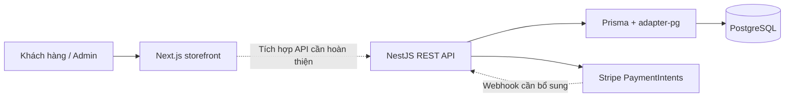
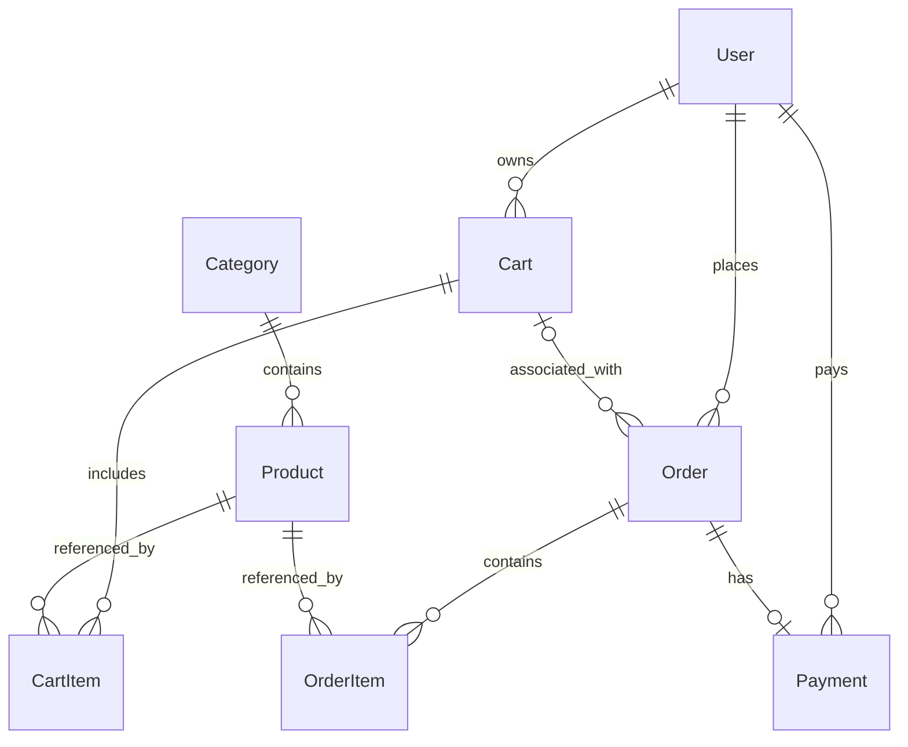

# Kiến trúc hệ thống

**Mốc cập nhật 06/11/2026:** AppModule dùng Prisma v2 và nạp Platform/Auth/Accounts/Access cùng Catalog/Pricing/Media/Inventory cơ bản. Mã v1 giữ trong `api/legacy/`, ngoài runtime. Contract: [danh tính](API_IDENTITY_V2.md), [catalog/giá/ảnh/kho](API_CATALOG_V2.md); bằng chứng kiểm tra tại [PROJECT_STATUS.md](PROJECT_STATUS.md). Sơ đồ v1 bên dưới chỉ dùng đối chiếu.

Catalog tách đọc public có điều kiện visibility khỏi các mutation admin. Pricing ghi tiền VND BigInt, serialize thành chuỗi; Inventory ghi balance/movement/audit/idempotency trong cùng transaction, khóa sản phẩm rồi balance. Media dùng local filesystem với UUID key và kiểm visibility khi đọc, chưa có object storage/worker dọn file. Storefront/Commerce v2 đã nạp: frontend đọc snapshot public và API riêng tư, đặt/huỷ COD với reservation + ledger. Payment COD là UNPAID. Cập nhật 08/11: [Stripe Checkout v2 sandbox](STRIPE_V2.md) dùng adapter riêng gọi mạng ngoài transaction; webhook/raw body hoặc retrieve xác minh từ provider trước ghi ledger. Worker định kỳ phục hồi/expiry, refund còn ở mức tạo yêu cầu xử lý ngoại lệ. [Contract](API_STOREFRONT_COMMERCE_V2.md), [hướng dẫn tích hợp](STOREFRONT_INTEGRATION.md).

## Mốc cập nhật và kiến trúc triển khai — 06/11/2026

Thiết kế module theo database v2 nằm ở [BACKEND_DESIGN.md](BACKEND_DESIGN.md). Rà mã ngày 06/11 cho thấy AppModule đã chuyển sang platform/auth/accounts/access và PrismaService dùng client v2; mã thương mại v1 nằm trong `api/legacy/`. Đây là quan sát tĩnh, chưa nghiệm thu runtime trong lượt này. Các mô tả v1 bên dưới giữ để đối chiếu lịch sử, không phải danh sách route v2 đang vận hành.

Theo yêu cầu người dùng, dự án bổ sung Docker, CI/CD, Nginx và AWS sau FE–BE. Nguồn thiết kế triển khai là [DEPLOYMENT_PLAN.md](DEPLOYMENT_PLAN.md): GitHub Actions xây image → ECR → SSM deploy lên EC2 Compose; Nginx nhận HTTPS và chuyển frontend/API; NestJS kết nối RDS private qua TLS. Browser gọi `/api/v1` cùng origin, server Next dùng đường dẫn API nội bộ. Database/secret tách theo môi trường; migration one-shot và rollback app có kiểm tra tương thích schema.

Baseline một EC2/RDS Single-AZ dành cho demo, có giới hạn sẵn sàng và có thể gián đoạn lúc deploy. Chi tiết vẫn là đề xuất; chưa có chứng cứ hạ tầng đã được tạo. Không thay thành ECS/Kubernetes/ALB trước khi nêu nhu cầu và trade-off.

## Cấu trúc nền và sơ đồ ứng dụng v1 lịch sử

Một repository chứa hai ứng dụng độc lập về package: Next.js storefront và NestJS API. Backend tổ chức theo module nghiệp vụ và dùng Prisma truy cập PostgreSQL. Chưa có cấu hình npm workspace ở root.

Đường nét đứt thể hiện phần cần hoàn thiện. Admin là tác nhân mục tiêu; chưa xác nhận có dashboard giao diện.

## Trách nhiệm các lớp

| Lớp | Trách nhiệm |
| --- | --- |
| Next.js App Router | Route, layout, ranh giới server/client và hiển thị UI |
| Components | Header/Footer, section trang chủ, card sản phẩm, UI dùng lại |
| Controller + DTO | HTTP contract, mô tả Swagger, validation và lấy danh tính đã xác thực |
| Guard/decorator | Xác thực JWT, phân quyền role, lấy user từ request |
| Service | Nghiệp vụ, ownership, quy tắc trạng thái, transaction và phối hợp tích hợp |
| PrismaService | Kết nối PostgreSQL qua adapter-pg, truy vấn theo schema |
| Stripe | Xử lý payment; trạng thái nội bộ cần được đồng bộ đáng tin cậy |

Luồng API hiện tại: request → guard → validation DTO → controller → service → Prisma/PostgreSQL hoặc Stripe → response. Các decorator throttling và cấu hình tồn tại chưa đủ để khẳng định giới hạn request đã có hiệu lực toàn hệ thống; cần kiểm tra guard và test.

## ERD v1 tại mốc rà soát ban đầu

Database public đã áp dụng [Prisma v2](database/PRISMA_V2.md), gồm 104 bảng sau migration lưu cấu hình PC, dùng VND và client riêng. Runtime service/DTO đã dùng v2; mã v1 chỉ là lịch sử và không được nạp. Sơ đồ dưới chỉ mô tả cấu trúc mã backend v1 theo [schema lưu trữ](../api/prisma/archive/schema.v1.prisma.bak); dữ liệu nguồn được lưu ở schema `legacy_v1`.

- UUID cho các model chính. Unique: email, SKU, category slug, orderNumber, Payment.orderId và cặp CartItem(cartId, productId).
- Giá được lưu bằng `Decimal(10,2)`; `OrderItem.price` là trường lưu giá lúc tạo đơn, nhưng logic hiện còn lấy từ request.
- `Order.shippingAddress` hiện là string tùy chọn; chưa có Address model riêng.
- Một User có nhiều Cart; Cart có `checkedOut`. Chưa thấy ràng buộc chỉ một active cart cho mỗi user.
- Một Order có tối đa một Payment theo unique orderId; cần cân nhắc mô hình payment attempts khi thiết kế retry.
- Enum Order hiện gồm `PENDING`, `PROCESSING`, `SHIPPED`, `DELIVERED`, `CANCALLED` (đúng cách viết đang có trong schema). Payment gồm `PENDING`, `COMPLETED`, `FAILED`, `REFUNDED`. Có enum không đồng nghĩa có đầy đủ luồng chuyển trạng thái.
- Một số quan hệ User/Order/Payment dùng cascade delete; cần xem xét lưu lịch sử giao dịch trước khi phát hành thật.

Nguồn đối chiếu v1: [schema.v1.prisma.bak](../api/prisma/archive/schema.v1.prisma.bak). Nguồn schema đích: [schema.prisma](../api/prisma/schema.prisma). Chuyển database thực tế vẫn cần migration và xem xét tương thích.

## API contract v1 lịch sử — không phải contract v2 hiện tại

Prefix: `/api/v1`; Swagger ở `/api/docs`. Bảng dưới là chỉ mục, chi tiết request/response và guard phải xem controller/DTO hoặc Swagger sau khi chạy ứng dụng.

| Nhóm | Đường dẫn dưới prefix | Nội dung |
| --- | --- | --- |
| Auth | `/auth/register`, `/auth/login`, `/auth/refresh`, `/auth/logout` | Đăng ký, phiên đăng nhập và token |
| Users | `/users`, `/users/me`, `/users/me/password`, `/users/:id` | Hồ sơ và quản lý tài khoản |
| Categories | `/categories`, `/categories/:id`, `/categories/slug/:slug` | CRUD và đọc danh mục |
| Products | `/products`, `/products/:id`, `/products/:id/stock` | Danh sách, CRUD và stock |
| Carts | `/carts/me`, `/carts/items`, `/carts/items/:itemId`, `/carts/me/items` | Giỏ hàng hiện tại |
| Orders | `/orders`, `/orders/admin/all`, `/orders/admin/:id` | Tạo, liệt kê, quản trị; route chi tiết khách cần rà lại |
| Payments | `/payments/create-intent`, `/payments/confirm`, `/payments`, `/payments/:id`, `/payments/order/:orderId` | PaymentIntent và tra cứu |

Response hiện chưa nên coi là contract thống nhất: nhiều service dùng `{ success, data, message }`, một số danh sách có pagination riêng và auth trả token/user trực tiếp. Khi tích hợp frontend, ghi rõ method, auth, request, response, lỗi và pagination cho từng endpoint; không tự đổi contract toàn hệ thống trong một sửa lỗi nhỏ.

## Thiết kế mục tiêu cần hoàn thiện

Thiết kế dữ liệu mở rộng ngày **05/11/2026** nằm trong [database v2](database/README.md), gồm ERD theo miền, [từ điển dữ liệu](database/DATA_DICTIONARY.md), [quy tắc transaction](database/TRANSACTIONS.md) và [migration/kiểm thử](database/MIGRATION.md). Schema đích đã được hiện thực hóa tại `api/prisma/schema.prisma`; [Prisma v2](database/PRISMA_V2.md) phân biệt schema/client mới với backend v1 và phần migration còn lại.

- Checkout đọc giá/stock từ database, lưu snapshot, tính tổng bằng quy tắc tiền tệ thống nhất; chống trừ tồn vượt mức khi đồng thời.
- Payment lấy amount từ Order; webhook xác minh chữ ký bằng raw body, lưu event ID để chống xử lý lặp, cập nhật payment/order/cart nhất quán.
- Không coi URL success hoặc xác nhận từ browser là bằng chứng cuối cùng của thanh toán.
- Hủy/hoàn tiền có điều kiện trạng thái và idempotency; chốt chính sách giữ tồn trước khi triển khai.

Các nội dung trên là yêu cầu thiết kế nội bộ, chưa phải tính năng đã triển khai. Với quyết định lớn, tạo ADR trong `docs/decisions/` theo cấu trúc: bối cảnh → phương án → quyết định → lý do/trade-off → hệ quả → cách kiểm chứng; ghi rõ trạng thái đề xuất hay đã chấp nhận.
