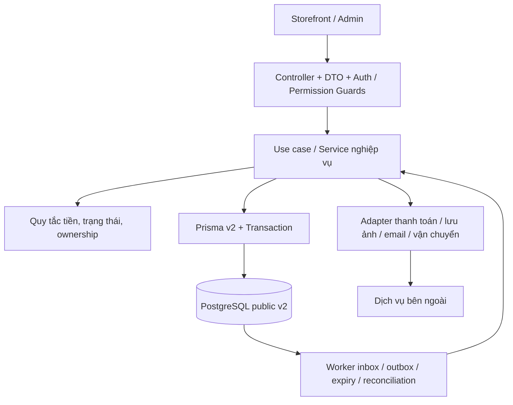
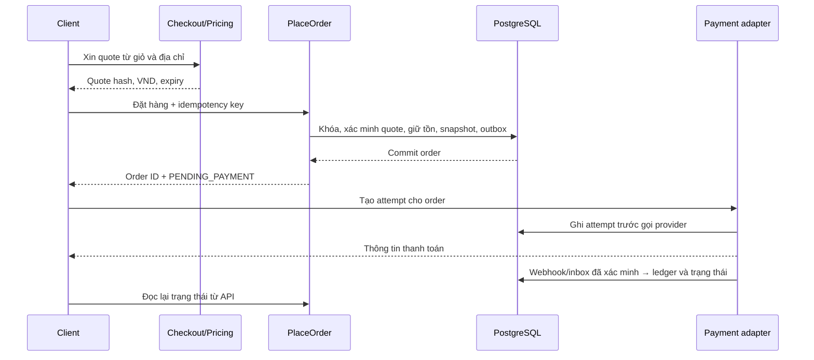

# Đề xuất backend v2 để duyệt

Ngày soạn **05/11/2026**; người dùng **đã duyệt ngày 06/11/2026**, bắt đầu với giai đoạn 0–1 rồi tiếp tục giai đoạn 2. Đã cài đặt [nền tảng/danh tính](API_IDENTITY_V2.md) và [catalog/giá/ảnh/kho cơ bản](API_CATALOG_V2.md); bằng chứng và giới hạn tại [PROJECT_STATUS.md](PROJECT_STATUS.md). Các nhóm nghiệp vụ còn lại bên dưới vẫn là thiết kế, không phải xác nhận chúng đã hoạt động.

Nguồn: [schema v2](../api/prisma/schema.prisma), [từ điển dữ liệu](database/DATA_DICTIONARY.md), [transaction](database/TRANSACTIONS.md), [trạng thái dự án](PROJECT_STATUS.md), `api/package.json` và các controller/service hiện tại.

## 1. Mục tiêu và điểm bắt đầu

Xây dựng backend bán lẻ có thể phục vụ storefront và trang quản trị: khách xem hàng → chọn SKU → đặt hàng → trả tiền → nhận hàng → đổi trả/bảo hành. Nhân viên có luồng quản lý sản phẩm, nhập kho, xử lý đơn, đối soát và chăm sóc khách hàng.

Tại thời điểm lập thiết kế, database public đã có 102 bảng v2, currency VND với minor_unit=0, còn backend dùng các trường v1 như `User.role`, `Product.price/stock`, `Order.totalAmount` nên không tương thích. Đến giai đoạn 2, runtime đã chuyển nền tảng/danh tính/catalog/giá/ảnh/kho cơ bản sang v2; mã v1 được giữ trong legacy ngoài runtime. Chưa mở luồng mua hàng/đơn/payment v2.

Các dữ liệu cần giữ khi phát triển: tài khoản/password hash đã migrate, catalog/SKU/giá/tồn/giỏ hiện có. Không đưa dữ liệu trong `legacy_v1` quay lại luồng mua hàng hoặc dùng archive làm database vận hành. Bốn media đang PENDING cần được xử lý thành một tác vụ import ảnh riêng.

## 2. Kiến trúc đề xuất

Dùng **modular monolith**: một ứng dụng NestJS, chia module theo nghiệp vụ và cùng dùng PostgreSQL. Module có thể chứa nhiều bảng; bảng nối/ledger không cần controller CRUD riêng. Giữ TypeScript ESM/NodeNext, import `.js`, Prisma và những công cụ đang có. Chưa bổ sung thư viện hoặc dịch vụ mới ở bước thiết kế.

Controller xử lý HTTP và validation; service thực hiện ca sử dụng như `PlaceOrder`, `ReserveStock`, `ApproveRefund`. Hàm tính giá/chuyển trạng thái thuần được tách để kiểm thử. Prisma truy cập dữ liệu; module phức tạp có query/repository riêng khi cần, không bắt mọi bảng qua generic repository.

Module chỉ ghi bảng do mình phụ trách. Khi một ca sử dụng cần nhiều module, một application service điều phối và truyền cùng transaction context vào các thao tác bên trong. Không để module tự mở các transaction độc lập rồi giả định toàn luồng đã nguyên tử. HTTP tới dịch vụ bên ngoài luôn nằm ngoài transaction database.

Dependency hướng về các capability như Pricing, Inventory và Access; không để Orders và Payments import vòng bằng `forwardRef` để chữa thiết kế. Use case xác nhận thanh toán nằm ở lớp điều phối, gọi capability ghi tiền và chuyển trạng thái đơn trong cùng transaction. Side effect email được phát qua outbox sau đó.

## 3. Bản đồ module và phần dữ liệu phụ trách

Tên module dưới đây là đề xuất tổ chức mã, không phải số lượng service/microservice phải triển khai. Mỗi bảng có một nơi chịu trách nhiệm ghi; module khác truy cập qua capability hoặc query dành cho đọc.

| Module | Bảng phụ trách ghi | Ý tưởng nghiệp vụ chính |
| --- | --- | --- |
| Accounts | `users`, `addresses` | Hồ sơ, trạng thái tài khoản, password hash, sổ địa chỉ; archive thay vì xóa mất giao dịch |
| Auth | `auth_sessions`, `auth_challenges` | Đăng ký phối hợp Accounts/Access, login, refresh theo thiết bị, logout, xác minh email, reset password |
| Access | `roles`, `permissions`, `user_roles`, `role_permissions` | Phân quyền theo nhiệm vụ; thay enum Role v1 bằng role code và permission |
| Catalog | `brands`, `categories`, `products`, `product_categories`, `product_variants`, `product_options`, `product_option_values`, `variant_option_values`, `attribute_definitions`, `category_attributes`, `product_attribute_values`, `variant_attribute_values`, `product_media` | Cây danh mục, trang sản phẩm, SKU, lựa chọn mua, thông số lọc, publish/archive và gắn media |
| Media | `media_assets` | Upload/import, validation loại/kích thước file, trạng thái READY, quyền truy cập file và dọn file không còn dùng |
| Pricing | `variant_prices`, `tax_classes`, `tax_rates` | Giá SKU, quy tắc thuế, làm tròn và tính giá quote; tiền VND là số nguyên |
| Inventory | `warehouses`, `inventory_balances`, `stock_reservations`, `inventory_movements`, `stock_transfers`, `stock_transfer_items`, `stock_counts`, `stock_count_items`, `serial_units`, `serial_unit_events` | Số dư, giữ/nhả/xuất/hoàn hàng, điều chỉnh, chuyển/kiểm kho và theo dõi serial |
| Procurement | `suppliers`, `supplier_variants`, `purchase_orders`, `purchase_order_items`, `goods_receipts`, `goods_receipt_items` | Nhà cung cấp → đơn mua → nhận hàng; chỉ receipt đã ghi sổ mới tăng tồn |
| Carts | `carts`, `cart_items` | Giỏ đăng nhập/guest, thêm SKU, kiểm quantity, hợp nhất khi login, version giỏ |
| Checkout | `checkout_sessions` | Điều phối giá/thuế/ship/coupon/địa chỉ thành quote có hạn; kiểm lại khi tạo đơn |
| Orders | `orders`, `order_items`, `order_addresses`, `order_item_taxes`, `order_status_history`, `order_notes`, `order_discounts`, `order_links` | Chụp snapshot giao dịch, đặt/hủy/xử lý đơn, lịch sử, ghi chú và liên kết đơn đổi hàng |
| Promotions | `promotions`, `promotion_products`, `promotion_categories`, `coupons`, `promotion_redemptions` | Luật giảm giá, điều kiện áp dụng, giới hạn lượt dùng và giữ lượt trong checkout tạo đơn |
| Payments | `payments`, `payment_attempts`, `payment_transactions`, `provider_events`, `refunds`, `refund_allocations`, `reconciliation_runs`, `reconciliation_issues` | Attempt, tiền thực thu/hoàn, webhook, idempotency, đối soát và xử lý UNKNOWN |
| Shipping | `shipping_methods`, `shipping_zones`, `shipping_rates`, `shipments`, `shipment_items`, `shipment_events` | Tính phí, đóng kiện theo kho, giao từng phần, tracking và xử lý giao thất bại |
| Returns | `return_requests`, `return_items`, `return_receipts`, `return_inspections` | Yêu cầu trả, duyệt, thực nhận, kiểm tra; phân biệt hàng tốt/hỏng và yêu cầu refund |
| Warranty | `warranty_policies`, `warranty_claims`, `warranty_events` | Chính sách snapshot và tiếp nhận/sửa/thay/bồi hoàn; serial thay đổi qua Inventory |
| Documents | `invoices`, `invoice_lines`, `credit_notes` | Chứng từ thương mại nội bộ và điều chỉnh; chưa coi là hóa đơn điện tử pháp định |
| Engagement | `wishlists`, `wishlist_items`, `reviews`, `review_media`, `review_votes` | Yêu thích, đánh giá mua hàng đã giao, moderation và bình chọn |
| Content | `content_pages`, `articles`, `banners`, `collections`, `collection_products` | Trang chính sách, bài viết, banner và nhóm sản phẩm trang chủ |
| Support | `support_tickets`, `support_messages`, `support_attachments` | Ticket khách hàng, người phụ trách, trao đổi công khai/nội bộ và file có kiểm quyền |
| Notifications | `notifications`, `notification_preferences`, `notification_deliveries` | Thông báo trong app, tùy chọn nhận và gửi email/SMS qua adapter khi được bật |
| Operations | `audit_logs`, `idempotency_keys`, `outbox_events` | Audit, chống request lặp, phát việc sau commit, theo dõi/replay tác vụ lỗi có quyền |
| Settings | `currencies`, `store_settings` | Cấu hình cửa hàng có validation và audit; không chứa secret hoặc tự sửa snapshot đơn cũ |

Platform là lớp hạ tầng dùng chung, không có bảng nghiệp vụ: config/env validation, Prisma v2, lỗi HTTP, logging/request ID, health, Swagger, validation, CORS và rate limit.

Reporting ban đầu là query đọc có kiểm quyền, không tạo thêm bảng hoặc cho ghi trực tiếp ledger. Báo cáo doanh thu phân biệt order đã đặt, tiền đã thu, tiền đã hoàn và chargeback; tiền thuần tính theo currency, không SUM mọi đơn kể cả hủy.

## 4. Ba nhóm API

Đề xuất giữ prefix `/api/v1` để phân biệt phiên bản HTTP với schema database v2. Chốt contract mới trước khi frontend tích hợp; không duy trì đồng thời các endpoint v1 cũ không tương thích. Swagger phải ghi rõ contract hiện hành.

| Nhóm | Mẫu route | Quyền |
| --- | --- | --- |
| Công khai | `GET /products`, `/products/:slug`, `/categories`, `/brands`, `/articles` | Chỉ nội dung đã publish; không lộ giá nhập/tồn chi tiết từng kho |
| Khách hàng | `/me`, `/me/addresses`, `/me/sessions`, `/cart`, `/checkout/quotes`, `/orders`, `/me/returns`, `/me/tickets` | Đăng nhập hoặc token guest ở đúng route cart; luôn kiểm ownership |
| Quản trị | `/admin/products`, `/admin/inventory`, `/admin/orders`, `/admin/refunds`, `/admin/access`, `/admin/reports` | Permission cụ thể, không chỉ tin prefix `/admin` |
| Tích hợp | `/webhooks/payments/:provider`, `/webhooks/shipping/:carrier` | Xác minh chữ ký/xác thực riêng theo adapter; không dùng JWT khách hàng |

API theo hành động nghiệp vụ: `publish`, `archive`, `reserve`, `post-receipt`, `cancel`, `ship`, `approve-refund`. Không expose PATCH tùy ý để biến đơn thành PAID/DELIVERED hoặc chỉnh số dư tồn/ledger.

Các endpoint dự kiến của luồng mua hàng:

| Method và route dưới prefix | Request chính | Kết quả/điều kiện |
| --- | --- | --- |
| `POST /auth/register`, `/auth/login`, `/auth/refresh`, `/auth/logout` | Thông tin hợp lệ; refresh qua cookie theo chính sách bên dưới | Session server-side; register không nhận role admin |
| `GET /auth/me` | Access JWT | Danh tính và các role/permission cho UI, không có hash/token |
| `POST /cart/items` | variantId, quantity | Giỏ tính từ giá server; chưa giữ hàng |
| `PATCH /cart/items/:id` | quantity, version kỳ vọng | Kiểm chủ giỏ và xung đột version |
| `POST /checkout/quotes` | cartId/version, addressId, shippingMethodId, coupon nếu có | Quote snapshot, tiền, hạn và các lỗi cần sửa |
| `POST /orders` | checkoutSessionId, quoteHash; header Idempotency-Key | Tạo đơn và reservation nguyên tử; không nhận giá từ client |
| `GET /orders/:id` | Danh tính | Snapshot và trạng thái order/payment/shipment độc lập |
| `POST /orders/:id/payment-attempts` | Phương thức đã enable; idempotency key | Amount/currency từ order; trả thông tin cần cho adapter |
| `POST /orders/:id/cancel` | Lý do; idempotency key | Kiểm trạng thái, release đúng một lần; phối hợp refund nếu đã thu |
| `POST /admin/shipments/:id/ship` | Kiện/serial đã chuẩn bị, version | Consume reservation và ghi shipment/history trong transaction |
| `POST /admin/refunds/:id/approve` | Quyết định, lý do; idempotency key | Giữ hạn mức hoàn dưới khóa payment; gọi provider sau commit |

Danh sách này là thiết kế route, chưa phải OpenAPI hoàn chỉnh. Khi triển khai từng lát, hoàn thiện DTO, response, lỗi, guard và Swagger cùng nhau.

## 5. Quy ước HTTP và dữ liệu

- Response thành công thống nhất `data` và `meta` khi cần pagination/requestId; lỗi có `error.code`, `message`, `details` đã lọc và requestId. Không trả HTTP 200 cho lỗi bằng cờ success=false.
- Money trên API là chuỗi số nguyên kèm currency, ví dụ `amount: "1500000", currency: "VND"`; server tính bằng BigInt. Có mapper riêng, không monkey-patch JSON toàn ứng dụng hoặc dùng Number để tính tiền.
- Thời gian ISO-8601 UTC; báo cáo chọn timezone nghiệp vụ rõ. ID dùng UUID, không nhận UUID làm bằng chứng ownership.
- List có limit tối đa; lịch sử lớn dùng cursor `(createdAt,id)`, màn admin đơn giản có thể dùng page/limit. Sort/filter theo allowlist, không nhận raw tên cột hoặc SQL.
- HTTP dự kiến: 400 input sai; 401 chưa xác thực; 403 thiếu quyền; 404 tài nguyên không thấy/không thuộc quyền xem; 409 version/idempotency/stock conflict; 429 rate limit; 503 phụ thuộc tạm không sẵn sàng. Giữ error code ổn định cho frontend.
- Idempotency key bắt buộc cho tạo đơn/attempt/refund và ghi sổ receipt/stock quan trọng; cùng key khác payload là conflict, không chạy lại tác vụ tài chính.
- Product response phân biệt productId với variantId; giá/tồn mua được nằm ở variant. Không tiếp tục contract v1 giả định một Product có một giá và một stock.

## 6. Xác thực và phân quyền

Đề xuất role seed `CUSTOMER`, `ADMIN`; vai trò nhân viên như kho/hỗ trợ mở sau bằng dữ liệu cấu hình. Không tự thêm enum Role cũ trở lại schema. Permission mẫu: `catalog.write`, `inventory.adjust`, `orders.manage`, `refunds.approve`, `access.manage`. ADMIN nhận permission đã seed qua bảng nối; không tự tạo tài khoản admin hoặc nâng quyền một tài khoản bất kỳ.

Register tạo user CUSTOMER và session trong transaction; email normalize, password hash bcrypt theo cấu hình. Access JWT đề xuất 15 phút, refresh session 7 ngày; là thông số cần duyệt, không khẳng định đã cài đặt. Refresh token hash trong auth_sessions, rotate/thu hồi theo thiết bị và có xử lý reuse. JWT xác thực phải từ chối user LOCKED/ARCHIVED và user không còn tồn tại.

Trình duyệt: access token giữ trong bộ nhớ, refresh trong cookie HttpOnly; Secure khi HTTPS, SameSite theo topology triển khai. Cookie-auth endpoint cần kiểm Origin/CSRF phù hợp, CORS chỉ cho origin được phép. Không ghi token vào log hoặc Swagger ví dụ thật. Swagger/CLI test cần thiết kế cách nhận cookie rõ ràng, không mở endpoint refresh bỏ bảo vệ chỉ để tiện test.

Guard lấy danh tính đã xác thực; permission lấy từ DB khi kiểm các thao tác quan trọng để việc thu hồi có hiệu lực, không chỉ tin role cũ trong JWT. Ownership nằm trong query/service. Staff có quyền xem đơn không mặc nhiên có quyền duyệt refund hoặc phân quyền người khác.

## 7. Luồng tiền, tồn và tác vụ nền

Tồn khả dụng = on_hand - reserved - unavailable. Checkout quote chưa giữ hàng; tạo order mới giữ. Payment thành công commit reservation; xuất giao mới giảm on_hand và reserved. Hủy/hết hạn chỉ nhả phần chưa giao đúng một lần. Worker hết hạn và webhook khóa cùng parent, không xử lý dựa vào state đã đọc trước transaction.

Giữ transaction ngắn và thứ tự khóa ổn định. Dùng cập nhật có điều kiện/row lock và retry giới hạn khi deadlock/serialization conflict. Không gọi provider trong callback Prisma transaction có thể retry.

Worker PostgreSQL xử lý: hết hạn đơn/reservation, inbox webhook, outbox thông báo, payment UNKNOWN/đối soát và cleanup dữ liệu tạm. Có lease, retry/backoff, dedupe, DEAD và thao tác replay có quyền. Không cam kết exactly-once cho HTTP bên ngoài; bảo đảm hiệu ứng nghiệp vụ không lặp qua unique key và transaction.

Chính sách đề xuất: đơn chờ thanh toán giữ 15 phút, quote 5 phút. Capture đến sau EXPIRED/CANCELLED vẫn ghi tiền thực thu và mở luồng hoàn/issue, không tự phục hồi đơn để giành lại hàng. Hàng trả chỉ restock sau inspection; refund không tự tăng tồn. Chi tiết tại [TRANSACTIONS.md](database/TRANSACTIONS.md).

## 8. Tích hợp bên ngoài và chính sách cần duyệt

| Điểm cần chốt | Phương án đề xuất để triển khai |
| --- | --- |
| Thanh toán đầu tiên | Giữ adapter riêng; ưu tiên kiểm thử Stripe test mode vì có SDK/mã ban đầu. Phải xác minh account/currency VND, hạn mức và contract hiện hành khi triển khai; không mặc định các giá demo hiện có đủ điều kiện thanh toán |
| COD/chuyển khoản | Thiết kế sẵn qua adapter/method nhưng chỉ enable khi có quy trình xác nhận và đối soát tiền; không đánh PAID bằng nút tùy ý |
| Shipping đầu tiên | Một kho, vùng/phí cấu hình trong DB và thao tác đóng/giao có quyền; kết nối carrier thật ở giai đoạn sau |
| Thuế/giá hiển thị | Giữ mô hình snapshot giá chưa gồm thuế của thiết kế; cần chốt quy tắc thực tế trước checkout. Không tự lấy tax_class null làm miễn thuế |
| Coupon | Một mã/quote ở lần đầu, không stacking; backend tính và phân bổ giảm giá. Mở rộng promotion tự động sau khi lõi ổn |
| Giữ hàng | Đề xuất quote 5 phút, order 15 phút; hai TTL cấu hình và snapshot, có test hết hạn |
| Hủy/đổi trả | Khách hủy khi chưa SHIPPED phần nào. Đề xuất cửa sổ trả 7 ngày kể từ giao để làm demo, chỉ áp dụng sau duyệt; không coi là chính sách pháp lý đã xác minh |
| Ảnh và file | Chọn một storage adapter khi triển khai Media; import bốn ảnh cũ có validate, không coi URL nguồn là uploaded file READY |
| Email | Local dùng adapter giả lập không gửi ra ngoài; provider thật chỉ cấu hình khi có nhu cầu. Chưa gửi email cho khách trong bước thiết kế |
| API version | Đề xuất giữ `/api/v1` và công bố contract mới; không cần đổi prefix chỉ vì database gọi là v2 |

Các thông số là đề xuất để chủ dự án duyệt, không được dùng như quyết định đã chấp nhận. Không cần chốt provider, storage hoặc chính sách hậu mãi để bắt đầu giai đoạn nền tảng.

## 9. Cấu trúc mã và cách chuyển hệ thống cũ

Giữ `api/src/modules/`, tổ chức thư mục theo capability ở bảng module; có thể đặt `pricing`, `inventory`, `access`, `checkout` cạnh module hiện tại. Trong mỗi module: controller/DTO, use case/service, query/mapper; chỉ thêm lớp rules/repository/adapter khi có logic thật. Tránh cả service khổng lồ và kiến trúc nhiều lớp không có trách nhiệm rõ.

Hạ tầng dùng chung đặt ở `common/`, `prisma/` và adapter có phạm vi rõ. Worker gọi use case/capability; không viết một bản nghiệp vụ khác cho job. Entry point worker có thể tách tiến trình từ cùng codebase khi cần, chưa đưa thêm queue/broker.

Giai đoạn chuyển đầu tiên phải xử lý toàn bộ module v1 còn được AppModule đăng ký. Khi PrismaService chuyển client v2, controller/service chưa migrate phải được tách khỏi runtime và build theo cơ chế rõ ràng, hoặc chuyển cùng lát; không để build pass nhờ kiểu client v1 nhưng route thực tế query sai DB. Ưu tiên giữ lịch sử mã bằng Git, không duy trì hai ứng dụng backend cùng ghi public/legacy_v1.

Mục tiêu kết thúc giai đoạn đầu: ứng dụng boot với public v2, chỉ route đã tương thích được đăng ký và mô tả trong Swagger, mọi import Prisma trong mã đang chạy cùng một nguồn. Cách cô lập mã v1 cụ thể được review trong thay đổi đầu tiên; không xóa/di chuyển hàng loạt trước khi có danh sách file và phạm vi được duyệt.

## 10. Thứ tự triển khai và tiêu chí qua giai đoạn

| Giai đoạn | Công việc | Đầu ra có thể nghiệm thu |
| --- | --- | --- |
| 0. Chuyển nền tảng v2 | Prisma client/import, config/env, boot, DTO/BigInt mapper, lỗi/Swagger, CORS/rate limit, health; cô lập route v1 chưa tương thích | Boot và build từ generate sạch; kết nối public v2; không cần key Stripe để chạy auth/catalog; Swagger không quảng bá route hỏng |
| 1. Danh tính và quyền | Accounts/Auth/Access, profile/address, session lifecycle, seed permission có kiểm soát | Login bằng hash đã migrate; register luôn CUSTOMER; refresh/logout/reset đúng; test chặn nâng quyền và đọc dữ liệu người khác |
| 2. Catalog có thể bán | Catalog/Pricing/Media và Inventory đọc/adjust tối thiểu; Settings VND | Đọc được catalog/SKU/giá/tồn migrate; admin chỉnh giá/nhập điều chỉnh có audit; publish và media status hợp lệ |
| 3. Luồng mua hàng lõi | Cart/Checkout/Orders, reserve/expiry, shipping fee/thuế đã chốt, payment/webhook/refund tối thiểu, idempotency/inbox/outbox | E2E sản phẩm → giỏ → quote → order → payment → hủy/hoàn; không bán vượt tồn, không thu/hoàn hai lần |
| 4. Fulfillment và hậu mãi | Shipping nhiều kiện, Returns/inspection, Documents, serial và Warranty | Giao/trả từng phần, hàng lỗi quarantine, tiền/tồn độc lập; chứng từ giữ snapshot và truy vết |
| 5. Vận hành hàng hóa | Procurement, chuyển/kiểm kho, payment reconciliation và báo cáo | Nhập/chuyển/kiểm có chứng từ, chống ghi sổ trùng; pending/UNKNOWN được theo dõi và đối soát |
| 6. Hoàn thiện sản phẩm | Promotions nâng cao, Engagement/Content/Support/Notifications và báo cáo mở rộng | Có acceptance criteria theo từng module; không phát hành chức năng chỉ vì có bảng |
| 7. Sẵn sàng phát hành | CI, integration/E2E tổng thể, phân quyền, log/monitor, deploy, backup/restore và runbook | Chạy được từ môi trường sạch, restore đã thử, không secret trong log, có quy trình xử lý sự cố |

Kiểm thử thực hiện trong từng giai đoạn, không dồn tới giai đoạn 7. Phần thông báo/outbox/audit tối thiểu đi cùng luồng quan trọng; giai đoạn 6 mới mở đầy đủ tính năng khách hàng. Không mở checkout thật khi payment/expiry/idempotency còn là stub.

## 11. Chiến lược kiểm thử và cách nghiệm thu

Unit kiểm tiền, phân bổ giảm/thuế, chuyển trạng thái và quyền. PostgreSQL integration kiểm FK/CHECK/partial unique, transaction và đồng thời; dùng DB test riêng, không dùng public hiện có làm nơi chạy bộ test xóa dữ liệu. API E2E kiểm auth/ownership và luồng mua hàng. Provider dùng fake adapter cho unit/integration, test mode khi xác minh tích hợp thật.

Các ca bắt buộc: hai người mua hàng cuối; hai lần đặt cùng giỏ; idempotency cùng key khác payload; hai refresh đồng thời/reuse; webhook giả/lặp/sai thứ tự; timeout tạo attempt; payment đến sau hết hạn; hai lần hủy/refund; hai shipment phân bổ trùng; trả hàng hỏng; user truy cập đơn/file của người khác; permission bị thu hồi sau khi phát JWT.

Mỗi lát giao hàng gồm: mục tiêu → nghiệp vụ/quy tắc → contract → file thay đổi → cài đặt → kết nối → validation/bảo mật → kiểm thử → kết quả thật/trade-off. Build/lint và test thích hợp phải qua; cập nhật Swagger, tài liệu và PROJECT_STATUS bằng bằng chứng. Nếu chỉ có test scaffold hoặc mock thành công thì không coi tích hợp đã nghiệm thu.

## 12. Phạm vi đề nghị duyệt

Đề nghị duyệt kiến trúc một ứng dụng NestJS, bản đồ module/phân quyền, contract tiền VND và thứ tự triển khai trên. Đợt code đầu tiên đề xuất giới hạn **giai đoạn 0–1**, đưa backend hoạt động với database v2 và làm đúng tài khoản/phiên/quyền trước; sau đó nghiệm thu rồi chuyển catalog và mua hàng.

Phê duyệt thiết kế không tự trở thành quyền chạy mọi migration, deploy, gửi email hoặc triển khai toàn bộ roadmap. Với lựa chọn tích hợp/chính sách còn mở, chốt trước giai đoạn liên quan. Trong lượt soạn tài liệu này chỉ tạo bản đề xuất và liên kết, chưa sửa mã backend, chưa chạy lại migration hoặc gọi dịch vụ bên ngoài.
