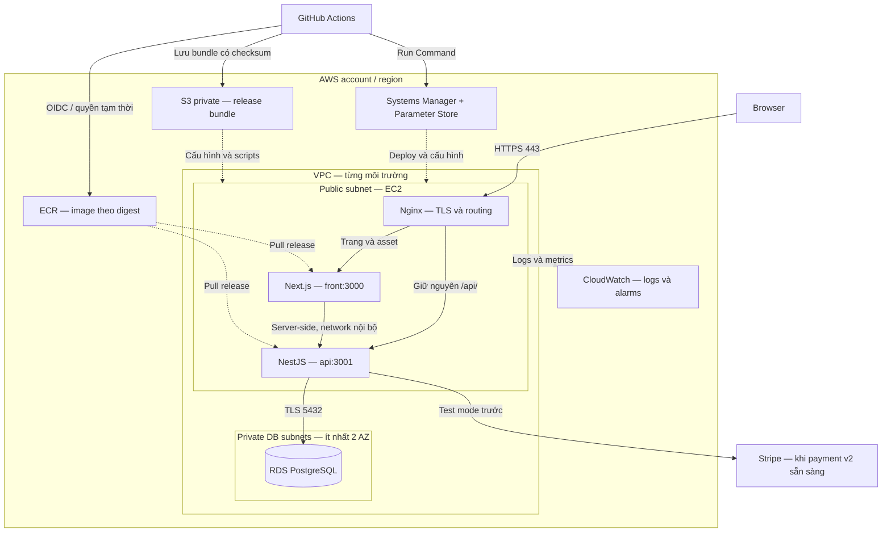

# Kế hoạch Docker, CI/CD, Nginx và AWS

Ngày lập: **06/11/2026**. Người dùng đã yêu cầu bổ sung bốn nhóm công nghệ sau phần frontend/backend. **Định hướng công nghệ đã được yêu cầu; cấu hình chi tiết dưới đây là thiết kế đề xuất để triển khai từng bước.** Tài liệu này không xác nhận đã có container, pipeline hoặc tài nguyên AWS.

## 1. Mục tiêu và phạm vi

Đưa ứng dụng từ máy phát triển lên một môi trường demo có HTTPS, quy trình phát hành lặp lại được, kiểm tra tự động, theo dõi lỗi và khả năng phục hồi. Chủ dự án cần tự giải thích được request đi đâu, image được tạo thế nào, credential nằm ở đâu và xử lý ra sao khi một bản phát hành lỗi.

Thứ tự chính: **hoàn thiện BE v2 và FE → tích hợp luồng thật → Docker → Nginx → CI → AWS staging → CD → demo và vận hành**. Có thể chuẩn hóa Node/env và thêm CI lint/build sớm; việc đó không đồng nghĩa FE–BE đã hoàn tất. Chưa mặc định thêm Kubernetes, ECS, Redis, queue, ALB hoặc Terraform vào đợt đầu.

### Những khái niệm cần hiểu

| Thành phần | Vai trò trong dự án | Bằng chứng cần tạo |
| --- | --- | --- |
| Docker image / container | Image là gói ứng dụng bất biến; container là tiến trình chạy từ image đó | Build trên Linux sạch, chạy lại cùng image với cấu hình khác |
| Docker Compose | Khai báo và chạy các container trên một máy | Service, network, volume, health check, lệnh khởi động có tài liệu |
| Nginx reverse proxy | Nhận HTTPS rồi chuyển request tới Next.js hoặc NestJS | Routing, header, giới hạn request và chứng chỉ được kiểm tra |
| CI — tích hợp liên tục | Mỗi thay đổi được kiểm lint/build/test trước khi hợp nhất | PR lỗi bị chặn bởi checks bắt buộc |
| CD — phân phối/triển khai liên tục | Đưa release đã kiểm tra lên môi trường đích bằng quy trình tự động | Phát hành theo digest, smoke test và rollback có bằng chứng |
| AWS | Cung cấp compute, database, registry, quyền và giám sát | Sơ đồ tài nguyên, chi phí, quyền tối thiểu và diễn tập phục hồi |

### Căn cứ tại workspace ngày 06/11/2026

- Hai manifest/lockfile riêng ở `api/` và `front/`; chưa có npm workspace, chưa pin Node ở cấp dự án. Chọn Node 24 làm ứng viên baseline dựa trên engines của dependency cục bộ; khi cài đặt phải chọn patch còn được hỗ trợ, xác minh clean install và pin thống nhất.
- `api/src/app.module.ts` hiện nạp platform/auth/accounts/access. Các module thương mại v1 đã chuyển vào `api/legacy/`; không quảng bá chúng là API v2 đang chạy. `PrismaService` hiện import client v2 tại `api/generated/prisma-v2`.
- Platform đã có validation env, HTTP envelope, CORS, throttling, shutdown hooks; health ở `/api/v1/health` và `/api/v1/health/ready`. Đây là quan sát mã, chưa kiểm chứng runtime trong lượt lập kế hoạch.
- `api/src/modules/auth/challenge-delivery.ts` chỉ giữ email challenge trong bộ nhớ local và từ chối khi `NODE_ENV=production`. Cần adapter email phù hợp hoặc giới hạn rõ chức năng demo trước khi nghiệm thu auth production; không đổi staging thành development để vượt chặn.
- `api/test/app.e2e-spec.ts` còn kỳ vọng `/` trả `Hello World!`, trong khi AppModule đã thay đổi. Cần sửa thành E2E có bootstrap HTTP thật và database test; chưa coi script tồn tại là check đang pass.
- Frontend có Playwright và `test:e2e`; cấu hình hiện chạy dev server, dùng mock và cho tái sử dụng server. Chưa phải E2E FE–BE hoặc kiểm tra image production. `next.config.ts` chưa có `output: 'standalone'`.
- Chưa thấy Dockerfile, Compose, cấu hình Nginx, workflow GitHub Actions hoặc IaC trong phạm vi workspace đã khảo sát. Tài liệu cũ có mô tả v1; khi triển khai phải đọc lại mã và [hiện trạng](PROJECT_STATUS.md).

## 2. Kiến trúc đề xuất

**Baseline:** GitHub Actions + Amazon ECR + một EC2 Linux chạy Docker Compose gồm Nginx, Next.js và NestJS; PostgreSQL ở RDS private. Chọn EC2 để học Linux, Docker/network/proxy và vận hành trực tiếp. RDS tách dữ liệu khỏi vòng đời container ứng dụng. [RDS trong VPC](https://docs.aws.amazon.com/AmazonRDS/latest/UserGuide/USER_VPC.WorkingWithRDSInstanceinaVPC.html).



Một EC2 là điểm lỗi duy nhất; deploy Compose thông thường có thể gián đoạn ngắn. RDS Single-AZ cũng chưa cung cấp mức sẵn sàng cao. Baseline dành cho demo/portfolio có vận hành cơ bản, không cam kết zero downtime hoặc SLA kinh doanh.

### Vai trò và cấu hình xuất phát

| Tài nguyên | Thiết kế ban đầu | Lý do / giới hạn |
| --- | --- | --- |
| Region | Đề xuất Singapore `ap-southeast-1` | Chốt sau khi so chi phí và độ trễ từ Việt Nam; đặt compute/DB/ECR cùng region |
| EC2 | Linux x86_64, ứng viên 2 vCPU/4 GiB RAM, EBS gp3 mã hóa | Build ở CI, EC2 chỉ pull/run; đo RAM/CPU và quyền dùng instance trước khi chốt loại |
| RDS PostgreSQL | Instance nhỏ Single-AZ, storage mã hóa, không public, backup 7 ngày | Chọn major theo database dev và kiểm tra migration/extension; chưa chốt theo trí nhớ |
| ECR | Repository riêng cho front/api; digest bất biến, lifecycle và quét lỗ hổng | Giữ release đang chạy và bản rollback, không chỉ giữ tag `latest` |
| Systems Manager | Agent + instance role + outbound HTTPS; dùng Session Manager/Run Command | Quản trị và deploy không cần mở SSH public |
| Parameter Store | SecureString phân tách staging/demo; KMS và IAM giới hạn đường dẫn | Cấu hình bí mật runtime; dùng Secrets Manager khi cần cơ chế rotation tương ứng |
| CloudWatch | Log group theo môi trường, retention khởi điểm 14 ngày và alarms | Cần agent/collector được cấu hình; Docker log driver mặc định chưa tự gửi log lên AWS |
| DNS và TLS | Domain của chủ dự án, DNS provider hiện có hoặc Route 53; Nginx kết thúc TLS | HTTP-01 ACME/Certbot và gia hạn tự động; Route 53 không bắt buộc |
| S3 release | Bucket private, versioning, mã hóa, Block Public Access; prefix tách môi trường | Lưu manifest/Compose/Nginx/scripts có checksum theo release; EC2 đọc mà không cần GitHub PAT |
| S3 media | Chỉ bổ sung ở giai đoạn upload ảnh; bucket/quyền riêng | Asset tĩnh có thể đi cùng image; không lưu ảnh upload cần giữ trong container |

Chọn một bản Linux có hỗ trợ và pin AMI khi triển khai; chọn cùng kiến trúc CPU cho build/run, kiểm tra bcrypt và dependency native. Nếu đổi ARM phải build/test image ARM trước. ALB/ACM/CloudFront/ECS là hướng mở rộng khi có nhu cầu thực tế, không phải yêu cầu cho release đầu.

## 3. Thiết kế các môi trường

| Môi trường | Cách chạy | Dữ liệu / bên ngoài | Truy cập và mục đích |
| --- | --- | --- | --- |
| Local nhanh | Next/Nest chạy trên host Windows; PostgreSQL bằng Compose hoặc DB local riêng | Dữ liệu giả, Stripe test, email local | FE 3000, API 3001; thuận tiện debugger/hot reload |
| Local đầy đủ | Compose chạy front/api/nginx/postgres | Volume riêng; seed giả lặp lại được | Qua `http://localhost:8080`; diễn tập routing giống deployment |
| CI | Runner Linux tạm thời, PostgreSQL test cùng major đã chọn | Database dùng một lần, không credential cloud ở PR | Kiểm tra từ checkout/lockfile sạch; xóa cùng job |
| Staging | Stack AWS riêng, runtime production | DB, secret, email sandbox, Stripe test riêng | `staging.<domain>`; bảo vệ truy cập, kiểm tra release trước demo |
| Demo | Stack AWS riêng, runtime production | Chỉ dữ liệu giả và Stripe test trong giai đoạn portfolio | `demo.<domain>` hoặc domain chính; là môi trường phát hành demo, chưa bán hàng thật |

Staging và demo không dùng chung database, volume, secret hoặc Stripe webhook secret. Đề xuất AWS account riêng khi vận hành thật; với portfolio cùng account có thể dùng VPC/EC2/RDS/roles tách theo môi trường, kiểm soát bằng IAM và tag. Staging được dựng theo phiên kiểm thử để giảm chi phí, không mặc định luôn bật hai bộ hạ tầng. Nếu chỉ đủ ngân sách một stack, làm staging trước rồi chuyển thành demo và ghi rõ chưa có staging thường trực; không giả lập hai môi trường bằng một DB dùng chung.

Local/test/staging/demo không mang dữ liệu khách thật. Stripe live, email gửi khách thật và dữ liệu thật là mốc phát hành khác, cần nghiệm thu nghiệp vụ và bảo mật riêng.

### Domain, mạng và Security Group

1. VPC có public subnet cho EC2, Internet Gateway và route tương ứng; EC2 có địa chỉ public để nhận HTTPS và outbound tới AWS APIs. Dùng Elastic IP nếu cần DNS ổn định, tính cả phí IPv4.
2. RDS ở DB subnet group gồm ít nhất hai private subnet thuộc hai AZ, kể cả chọn Single-AZ. Không cấp public access; Security Group DB chỉ nhận TCP 5432 từ Security Group EC2. [Yêu cầu subnet của RDS](https://docs.aws.amazon.com/AmazonRDS/latest/UserGuide/USER_VPC.WorkingWithRDSInstanceinaVPC.html).
3. EC2 chỉ mở inbound 80/443; 80 phục vụ ACME/redirect. Không publish host port 3000/3001/5432 ở AWS, không mở 22 mặc định. Docker network dành cho Nginx/front/api; frontend không được nhận credential DB.
4. SSM Agent cần IAM instance profile và kết nối outbound 443 tới endpoint AWS liên quan; không coi đóng port 22 là đã cấu hình xong SSM. Baseline public EC2 có outbound qua Internet Gateway; chưa cần NAT Gateway. [Điều kiện Session Manager](https://docs.aws.amazon.com/systems-manager/latest/userguide/session-manager-prerequisites.html).
5. Tách SG và quyền theo môi trường. Quản trị DB bằng SSM tunnel hoặc migration job nội bộ; không mở DB toàn Internet để GitHub runner kết nối.
6. Kết nối RDS dùng TLS, xác minh hostname/chứng chỉ bằng CA phù hợp trong adapter-pg và migration CLI. Bổ sung cấu hình hiện còn thiếu, test CA sai phải thất bại; không dùng `rejectUnauthorized: false` làm cách sửa. [TLS của RDS](https://docs.aws.amazon.com/AmazonRDS/latest/UserGuide/UsingWithRDS.SSL.html).

### HTTPS và chứng chỉ

Chưa có domain được chốt. Khi có domain: trỏ DNS → khởi động HTTP/ACME challenge → cấp chứng chỉ → bật 443 và redirect → thử gia hạn → cảnh báo hết hạn. Chứng chỉ/private key nằm trong volume/host path được bảo vệ, mount read-only vào Nginx; giữ qua việc thay container. Tác vụ gia hạn reload Nginx sau khi `nginx -t` thành công. Không nhúng private key vào image/Git. Chưa bật HSTS `includeSubDomains` trước khi toàn bộ subdomain phục vụ HTTPS ổn định.

### Thứ tự dựng AWS lần đầu

Chốt estimate/account/domain → MFA và IAM vận hành → VPC/subnet/SG → ECR và S3 release → secret store/DB roles → RDS và backup → EC2 instance profile/SSM → Docker Engine + Compose plugin được pin và dịch vụ tự khởi động → bootstrap thư mục release/env/cert với quyền phù hợp → OIDC/roles/GitHub environments → DNS/ACME → release staging đầu tiên → smoke/rollback/reboot/restore. Ghi resource ID và cấu hình không bí mật trong `infra/aws/README.md`, không ghi credential. Provision ban đầu có thể dùng Console/CLI theo runbook; đây chưa phải IaC có thể tái tạo hoàn toàn. Khi cần tái tạo thường xuyên mới quyết định công cụ IaC và quản lý state.

## 4. Docker và cấu trúc file dự kiến

Các đường dẫn dưới đây là **đầu ra sẽ tạo khi cài đặt**, không phải file hiện đã có:

```text
api/Dockerfile                         # stages: dependencies, build, runtime, migrate
api/.dockerignore
api/.env.example                       # tên biến và giá trị giả, không secret thật
front/Dockerfile                       # build + Next standalone runtime
front/.dockerignore
front/.env.example
compose.yaml                           # baseline chạy đầy đủ ở local
compose.dev.yaml                       # override hot reload khi cần
compose.deploy.yaml                    # image digest + cấu hình deployment
.env.example                           # biến Compose không bí mật
infra/nginx/nginx.conf
infra/nginx/templates/store.conf.template
infra/scripts/deploy.sh
infra/scripts/rollback.sh
infra/scripts/smoke-test.sh
infra/aws/README.md                     # provisioning, IAM, DNS, tagging, cleanup
.github/workflows/ci.yml
.github/workflows/release.yml
.github/workflows/deploy.yml
docs/runbooks/DEPLOYMENT.md             # lệnh thực tế sau khi triển khai/kiểm chứng
docs/runbooks/RECOVERY.md
```

### Quy tắc image

- Chọn Node 24 patch tương thích, pin phiên bản/digest base image cho cả CI và Docker. Ứng viên `bookworm-slim` để giảm khác biệt libc/native modules; đo kích thước và scan sau build. Cập nhật pin qua thay đổi có review, không đóng băng vĩnh viễn.
- Multi-stage build: `npm ci` đúng lockfile từng app; build ở builder; runtime chỉ nhận artifact/dependency cần thiết. Chạy non-root, chỉ mở port nội bộ, tắt dev tools/debugger. Các thư mục cache/temp được cấp quyền riêng nếu harden filesystem.
- `.dockerignore` loại `.env*` trừ file mẫu khi cần, `.git`, `node_modules`, build/test output, credential và tài liệu không cần runtime. Không copy node_modules từ Windows vào Linux; không truyền secret bằng build arg hoặc layer.
- Postinstall hiện có `prisma skills sync || exit 0`: khi làm Docker/CI phải tách rõ thao tác đồng bộ tài nguyên AI khỏi build sản phẩm. Không dùng `--ignore-scripts` toàn cục mà chưa kiểm tra dependency cần lifecycle/native install.
- `npm ci` xong phải chạy generate client v2 trước build backend; giữ cả artifact `generated/prisma-v2` trong image ở đường dẫn khớp import tương đối từ JS đã biên dịch. Kiểm tra output thực tế và khởi chạy image để xác nhận `start:prod`, không suy từ tên script.
- Prisma CLI/config/schema/migrations có trong target `migrate` riêng; runtime API không cần quyền DDL. Build/generate không kết nối database thật: nếu Prisma config cần `DATABASE_URL`, dùng giá trị giả chỉ để đọc config, không chạy migration lúc build.
- Frontend chọn `output: 'standalone'`; copy cả `.next/standalone`, `.next/static`, `public`, đặt host listen `0.0.0.0` và port 3000. Chạy production server, kiểm asset/image/SSR và PC Builder; không dùng `next dev` trên AWS. Đối chiếu hướng dẫn Next cục bộ trước khi sửa config.
- PostgreSQL local dùng named volume, health check và restart policy. `depends_on: condition: service_healthy` giải quyết thứ tự khởi động; ứng dụng vẫn cần timeout/retry kết nối và xử lý DB mất sau startup. Docker health status không tự bảo đảm restart container bị unhealthy. [Compose startup order](https://docs.docker.com/compose/how-tos/startup-order/).
- Chạy migration một lần trước ứng dụng hoặc qua one-shot service thành công; không để mỗi replica tự migrate lúc boot. Nginx chỉ phục vụ traffic sau checks phù hợp. Log rotation, giới hạn tài nguyên và thời gian graceful shutdown phải được định nghĩa.

Hai Compose mode phải có lệnh rõ ràng; không trộn Postgres local vào AWS RDS. `compose.deploy.yaml` là cấu hình deployment riêng, chạy qua `docker compose -f compose.deploy.yaml ...`, không tự merge với file local có DB/volume/dev mount. Không dùng `docker compose down -v` trong quy trình phát hành.

## 5. Nginx và luồng dữ liệu

### Routing

| Request bên ngoài | Đích | Điều kiện |
| --- | --- | --- |
| `/`, route storefront, `/_next/*`, asset | `front:3000` | Giữ hành vi SSR/streaming và các header Next |
| `/api/v1/*` | `api:3001` | Giữ nguyên prefix `/api/v1`; không strip URI |
| `/api/docs*`, tài liệu OpenAPI | API nếu được phép | Hạn chế bằng cấu hình môi trường, mạng/quyền; kiểm cả JSON của Swagger |
| `/api/v1/health` | API liveness | Có thể dùng probe ngoài, response không lộ cấu hình |
| `/api/v1/health/ready` | API readiness kiểm DB | Probe nội bộ host/container, hạn chế công khai |
| Endpoint webhook | API sau khi payment v2 có route thật | HTTPS, không browser auth/Basic Auth, không cache, giữ nguyên body/signature |

Ví dụ chỉ giải thích giữ URI, **chưa phải cấu hình Nginx sẵn sàng chạy**:

```nginx
# Bên trong server có server_name hợp lệ và TLS được cấu hình riêng.
location /api/ {
    proxy_pass http://api:3001;
    proxy_set_header Host $host;
    proxy_set_header X-Forwarded-Proto $scheme;
    proxy_set_header X-Forwarded-For $remote_addr;
}
location / {
    proxy_pass http://front:3000;
    proxy_set_header Host $host;
    proxy_set_header X-Forwarded-Proto $scheme;
    proxy_set_header X-Forwarded-For $remote_addr;
    proxy_buffering off;
}
```

`proxy_pass` không thêm URI ở cuối để chuyển nguyên `/api/...`; thay thành upstream có `/` sẽ thay phần location được khớp. Kiểm bằng request route thực, tránh lỗi 404 do mất prefix. Khi tái tạo container upstream có thể đổi IP: deploy script cần reload/recreate Nginx sau khi upstream mới ready, hoặc triển khai DNS resolver phù hợp bản Nginx được pin rồi kiểm chứng. [Nginx proxy module](https://nginx.org/en/docs/http/ngx_http_proxy_module.html).

### Header, auth, cache và giới hạn

- Nginx edge phải ghi đè forwarded headers từ client; backend chỉ trust proxy đã biết/đúng topology một hop, không `trust proxy=true` tùy tiện. Kiểm IP dùng cho throttling và `X-Forwarded-Proto=https` qua proxy; giới hạn request không được gom mọi khách thành IP Nginx.
- Browser gọi đường dẫn tương đối `/api/v1`, cùng origin storefront. Khi dev chạy hai port, cấu hình API origin local hoặc proxy dev riêng. Server Component gọi qua `API_INTERNAL_URL=http://api:3001/api/v1` ở runtime; đây là biến **đề xuất**, chưa được mã hiện tại đọc. Server-side request phải chủ động chuyển credential cần thiết và dùng origin từ cấu hình tin cậy; không tin header tùy ý để vượt `AuthOriginGuard`.
- Giữ chính sách refresh cookie hiện có: HttpOnly, Secure khi production, SameSite Lax, path `/api/v1/auth`, host-only. CORS chỉ allow exact origin, credentials khi cần; test Origin hợp lệ/thiếu/giả, refresh, logout qua HTTPS. Cùng origin không tự thay thế chống CSRF.
- Không đưa JWT/DB/email/Stripe secret vào `NEXT_PUBLIC_*`. Giá trị public bị đóng vào bundle lúc build, nên đổi env runtime không thay nó. Dùng URL tương đối và cấu hình server runtime để promote cùng image giữa staging/demo; với public value khác nhau phải thiết kế config runtime an toàn hoặc ghi rõ cần build riêng. Chế độ render/cache Next phải cho phép đọc biến runtime, không vô tình prerender dữ liệu riêng tư. [Next environment variables](https://nextjs.org/docs/app/guides/environment-variables).
- Giai đoạn đầu không bật proxy cache cho HTML/API/tài khoản/checkout hoặc response có cookie. Asset theo hash có thể giữ cache header của Next. Không cache token, lỗi auth, RSC hay dữ liệu người dùng; không tắt buffering toàn hệ thống nếu chỉ cần streaming ở frontend.
- Định nghĩa body limit theo route và nhu cầu upload, timeout kết nối/đọc, rate limit thận trọng cho auth; kiểm upload hợp lệ và quá giới hạn. Webhook có policy riêng, không chặn bằng Origin của browser; Stripe signature và idempotency vẫn do API xử lý.
- Với staging có Basic Auth/IP restriction, runner smoke/E2E cần cách truy cập hợp lệ; webhook test có ngoại lệ đúng route. Header/query/token/cookie nhạy cảm phải được che trong Nginx và ứng dụng logs; request ID liên kết được giữa các lớp.

## 6. Biến môi trường và secret

| Nhóm | Tên / trạng thái | Cách quản lý |
| --- | --- | --- |
| API hiện đọc | `NODE_ENV`, `PORT`, `DATABASE_URL`, `DATABASE_SCHEMA`, `ALLOWED_ORIGINS` | Runtime; DB URL là secret, schema phải đúng môi trường |
| Auth hiện đọc | `JWT_SECRET`, `JWT_REFRESH_SECRET`, `JWT_EXPIRES_IN`, `REFRESH_TTL_SECONDS` | Secret tách theo môi trường, access/refresh khác nhau; rotation có kế hoạch vô hiệu phiên |
| FE đề xuất | `API_INTERNAL_URL`; URL browser tương đối | Chỉ server được đọc địa chỉ nội bộ; chưa có contract env này trong code |
| Deploy đề xuất | `AWS_REGION`, ECR repo, instance ID, role ARN, image digest, domain | GitHub environment variables/manifest; không phải credential bí mật |
| Payment/email khi có adapter | Stripe test secret/webhook secret và cấu hình provider email | Chuẩn hóa tên biến trong code + `.env.example` khi triển khai; không yêu cầu Stripe key để boot module chưa dùng |
| TLS với RDS | CA bundle và cấu hình xác minh TLS | Artifact CA công khai được pin/cập nhật; DB password ở secret store |

Local dùng file bị gitignore; CI tạo credential dùng một lần cho DB test. AWS runtime lấy SecureString bằng EC2 role rồi dựng env file chỉ root đọc, ngoài checkout, không log nội dung. File/env vẫn có thể đọc bởi quản trị host/container: giới hạn quyền Docker/SSM, bật IMDSv2 và không đưa AWS credential vào container. API DB role chỉ DML cần thiết; migration role có DDL, chỉ cấp cho one-shot migration, không trộn vào env API lâu dài.

Repo chỉ giữ `.env.example` với placeholder và giải thích. Không in `docker inspect`, resolved Compose env, connection string hoặc secret parameter ra Actions logs/artifacts. Secret rotation cần reload/recreate service nhận giá trị mới, kiểm phiên đang dùng và ghi rõ phạm vi ảnh hưởng.

## 7. Thiết kế CI/CD

### Luồng Git và CI

Dùng feature branch → PR → nhánh chính `main` (kiểm tra tên nhánh thực tế lúc cài đặt), branch protection và required checks. Không cần thêm nhánh `develop` cho một người. Tách job theo app, luôn có job kết luận required check; path filter không được làm check bắt buộc treo khi chỉ sửa docs hoặc khi sửa file dùng chung.

| Job CI | Công việc cần thực hiện | Điều kiện đạt |
| --- | --- | --- |
| API static/unit | `npm ci`, Prisma validate/generate v2, lint, build, unit test | Không thiếu generated artifact; unit hiện có thực sự chạy, không `passWithNoTests` |
| API integration/E2E | DB PostgreSQL tạm, migration từ empty, seed test tối thiểu, auth/ownership/transaction tests | Không trỏ DB dev/demo; sửa E2E scaffold; bootstrap giống `main.ts` |
| FE checks | `npm ci`, lint, `format:check`, build, Playwright Chromium | Suite mock hiện có vẫn chạy và được ghi đúng phạm vi |
| FE–BE E2E | FE production + API + DB test qua Nginx; thêm suite thật | Login/refresh/catalog/cart/order/test payment theo phạm vi đã triển khai |
| Images | Build production images Linux, khởi chạy, health/asset/proxy smoke, scan | Kiến trúc CPU đúng; image không thiếu generated client/static assets; phát hiện critical có cách xử lý |
| Docs | Kiểm link nội bộ, placeholder và diff | Không chạy DB/Stripe vì PR chỉ sửa tài liệu |

Chỉ yêu cầu các job phản ánh phần đã triển khai; khi chức năng chưa có phải ghi pending, không tạo check xanh giả. Bản E2E qua image phải có cấu hình Playwright riêng hoặc mode CI dùng production server với `reuseExistingServer=false`, seed xác định, artifacts khi fail; không lấy server dev đang chạy làm bằng chứng. Mock UI test và integration test thật là hai mức kiểm chứng khác nhau.

PR từ fork không được cấp AWS role/secret deploy; không dùng `pull_request_target` để chạy mã PR không tin cậy với secret. Pin action theo commit SHA được review khi tạo workflow; quyền mặc định `contents: read`, chỉ job cần AWS mới có `id-token: write`.

### Release và deploy

1. Merge nhánh chính: lấy đúng commit đã qua checks, build image front/api một lần và push ECR; gắn full Git SHA, ghi image digest. Nếu CI và release là workflow khác, ràng buộc commit/check rõ ràng, không lấy image từ PR không tin cậy.
2. Tạo release manifest gồm Git SHA, hai image digests, phiên bản cấu hình Nginx/Compose/scripts, migration đi kèm. Đóng gói manifest và cấu hình/scripts thành bundle không bí mật, lưu ở S3 private theo full SHA với version ID/checksum; giữ cùng cửa sổ rollback. SSM nhận định danh bundle, host tải bằng instance role và xác minh checksum trước khi chạy; không `git pull` nhánh mới nhất hoặc giữ GitHub PAT trên host. Chỉ digest không đủ nếu cấu hình chạy đã đổi.
3. Giả định AWS role qua GitHub OIDC, trust giới hạn đúng repo và branch/environment, audience `sts.amazonaws.com`. Role release chỉ push ECR/ghi bundle vào prefix S3 cho phép; role deploy giới hạn SSM document và EC2/tag môi trường; không cấp AdministratorAccess. [GitHub OIDC với AWS](https://docs.github.com/en/actions/how-tos/secure-your-work/security-harden-deployments/oidc-in-aws).
4. Deploy staging qua SSM Run Command; EC2 instance role chỉ pull ECR, đọc release bundle/secret môi trường đó và ghi logs. Không cần copy AWS access key/SSH private key lên GitHub.
5. Serialize deploy bằng GitHub concurrency theo môi trường **và khóa trên host**. `cancel-in-progress: false` cho deploy; job bị hủy không bảo đảm lệnh SSM từ xa đã dừng. Poll command tới trạng thái cuối, có timeout và log đã che bí mật; không coi `SendCommand` được nhận là deploy thành công.
6. Host kiểm dung lượng, manifest, kết nối DB/registry và backup; pull image theo digest trước khi chạm release đang chạy. Chạy migration một lần với quyền riêng; thất bại thì dừng, không thay app đang chạy.
7. Cập nhật services, chờ readiness có hạn thời gian; kiểm `nginx -t`, reload/recreate upstream routing; chạy smoke/E2E staging qua HTTPS. Nếu lỗi, áp quy trình rollback ở phần 8 và đánh dấu release thất bại.
8. Sau staging đạt, promote **đúng manifest/digest** lên demo qua environment gate/manual dispatch; không rebuild app trên EC2. Đề xuất thao tác phát hành có chủ đích cho demo; nếu GitHub plan không có required reviewers phù hợp thì giới hạn người chạy `workflow_dispatch`, quyền branch và AWS role, ghi rõ giới hạn kiểm soát.
9. Kiểm HTTPS/health/auth/read-only flow, theo dõi error rate/latency và ghi release cuối thành công. Khi smoke cần ghi dữ liệu, dùng tài khoản/dữ liệu test và cleanup có giới hạn; không tạo payment thật.

Như vậy giai đoạn đầu tự động phân phối và deploy staging; demo phát hành có gate. Chưa gọi toàn bộ quy trình là tự động deploy production thật. Đây là thiết kế workflow tương lai, không phải lệnh tự triển khai trong phiên viết kế hoạch.

## 8. Migration, rollback và phục hồi

### Database migration

- Production/staging chỉ áp migration đã review bằng `prisma migrate deploy`; không `db push`, `migrate dev`, reset hoặc cleanDatabase trên môi trường phát hành.
- Lịch sử chứa migration nâng v1 lên v2, archive và backfill: cần đọc [migration hiện có](database/MIGRATION.md), thử trên DB trống và bản sao dữ liệu giả có cấu trúc đại diện; rà CHECK/partial index/SQL riêng đã nằm đúng trong lịch sử hay chưa. Không tự chạy lại SQL bổ sung theo thói quen.
- Mỗi lần chỉ một migration runner. Backup trước thay đổi rủi ro, đặt timeout/giám sát lock; API cũ phải còn tương thích trong lúc chuyển giao. Seed role/permission/admin nếu cần phải idempotent, không hardcode mật khẩu admin.
- Ưu tiên expand–migrate–contract: thêm cột/bảng tương thích → chuyển code/dữ liệu → xóa cũ ở release sau. Với thay đổi phá vỡ tương thích phải có maintenance window và kế hoạch phục hồi riêng.

### Khi phát hành lỗi

1. Migration chưa chạy/thất bại: giữ app cũ, thu log đã che bí mật, kiểm trạng thái migration; không tự reset hoặc retry vô hạn.
2. Migration thành công, app/smoke lỗi: chỉ tự rollback app khi schema mới tương thích manifest trước. Pull lại digest/config trước, recreate/reload, kiểm health và HTTPS. Chưa có database down migration tự động.
3. Schema không tương thích hoặc dữ liệu bị hỏng: bật maintenance/dừng ghi theo runbook, đánh giá forward fix so với restore; quyết định theo phạm vi mất dữ liệu. Không tự restore đè DB đang phục vụ.
4. Backup/snapshot/PITR phục hồi sang RDS instance mới, kiểm dữ liệu và quyền trước khi chuyển endpoint; giữ nguồn cũ để điều tra. Nếu đã có payment bên ngoài, phải đối soát lại các sự kiện sau mốc phục hồi.

ECR lifecycle giữ các release đang chạy, ít nhất bản thành công trước và các bản trong cửa sổ phục hồi; cleanup chỉ sau khi xác định references. Dọn image/log an toàn, không xóa volume hoặc chạy prune tùy tiện khi rollback còn cần image.

### Backup và mục tiêu phục hồi

Đề xuất backup RDS 7 ngày + snapshot trước migration rủi ro; mã hóa và quyền đọc theo môi trường. RDS backup hỗ trợ khôi phục theo thời điểm trong retention, nhưng phải diễn tập mới kết luận phục hồi được. [RDS backups](https://docs.aws.amazon.com/AmazonRDS/latest/UserGuide/USER_WorkingWithAutomatedBackups.html).

Mục tiêu ban đầu cho demo: **RPO ≤ 24 giờ**, **RTO ≤ 4 giờ**; đây là mục tiêu thiết kế chưa đo. RPO là lượng dữ liệu tối đa có thể mất tính theo thời gian; RTO là thời gian khôi phục dịch vụ. Diễn tập trước nghiệm thu: chọn mốc → restore sang DB mới → kiểm count/constraint/tài khoản/đơn mẫu → trỏ app kiểm tra → ghi thời gian, dữ liệu mất và chi phí cleanup. Chưa hứa mục tiêu chặt hơn chỉ vì đã bật PITR.

## 9. Logs, cảnh báo và chi phí

### Vận hành tối thiểu

- Ứng dụng ghi stdout/stderr có thời gian, môi trường, release SHA và request ID. Thu Nginx/app logs vào CloudWatch bằng collector được cấu hình, log rotation tại host; không log password/token/cookie/body auth hoặc query có bí mật.
- Health probe phân biệt liveness với readiness; chỉ báo sống không chứng minh schema/luồng mua hàng đúng. Không restart liên tục chỉ vì RDS tạm ngắt; có timeout/retry hữu hạn và kiểm lỗi.
- Alarm cho EC2 status checks, CPU, disk, memory, RDS storage/connections, HTTP 5xx, latency và TLS expiry. Memory/disk cần agent/metric tương ứng; đặt ngưỡng sau phép đo baseline. Khởi điểm điều tra khi disk >80%, RAM >85% kéo dài; không coi đây là SLO đã đo.
- Có probe HTTPS ngoài host và nơi nhận cảnh báo do chủ dự án chọn; thiết lập chưa đồng nghĩa gửi cảnh báo thử thành công. Theo dõi payment reconciliation khi module payment được đưa vào dùng.
- Runbook ngắn cho 502/504, DB unreachable, secret sai/đã rotate, hết đĩa, cert hết hạn, release health fail và host reboot. Reboot phải tự khởi động Docker/stack; host mất hoàn toàn phải dựng lại từ image/cấu hình và RDS giữ dữ liệu.

### Kế hoạch ngân sách

Chưa biết hạn mức tháng/tài khoản AWS nên **chưa chốt tổng tiền hoặc giả định Free Tier**. Trước khi tạo tài nguyên, lưu estimate theo region/ngày ở [AWS Pricing Calculator](https://calculator.aws/) cho hai kịch bản: một demo chạy liên tục và demo + staging theo phiên. Công thức: giờ compute × đơn giá + EBS/RDS/storage/backup + public IPv4 + ECR + logs/metrics + DNS/domain + data transfer + dịch vụ tùy chọn/thuế.

| Nhóm chi phí | Phải đưa vào estimate | Cách hạn chế |
| --- | --- | --- |
| EC2/EBS/IPv4 | Instance, root/data disk, địa chỉ public, lưu lượng | Build ở CI; staging theo phiên; đo trước khi tăng cấu hình |
| RDS | Instance, storage/IO, backup/snapshot giữ lại | Single-AZ cho demo, retention rõ; vẫn tính storage/backup khi compute dừng |
| ECR/CI | Image storage/scan, transfer và GitHub Actions usage theo plan | Cache có kiểm soát, lifecycle giữ release cần thiết |
| Logs/metrics | Ingestion, retention, alarms/custom metrics | Không log request body, retention và sampling có chủ đích |
| DNS/TLS/S3 | Domain/hosted zone, S3 release storage/requests/versioning; media nếu dùng | Dùng DNS sẵn có; lifecycle release có xét rollback, media/CDN chỉ thêm khi cần |
| Dịch vụ mạng tùy chọn | NAT Gateway, ALB, VPC endpoints | Baseline chưa cần; phải tính lại nếu thay topology |

Tạo AWS Budget theo trần được chốt, cảnh báo 50%/80%/100% và forecast; Budget là cảnh báo, không phải giới hạn cứng tự chặn hóa đơn. Dữ liệu chi phí có độ trễ. [AWS Budgets](https://docs.aws.amazon.com/cost-management/latest/userguide/budgets-managing-costs.html). Gắn tag `Project`, `Environment`, `Owner`; cleanup staging, snapshot/image/log không cần giữ theo danh mục có review. Không tự xóa dữ liệu demo chỉ để giảm hóa đơn.

## 10. Các đợt triển khai và tiêu chí hoàn thành

| Đợt | Mục tiêu / việc làm | Tiêu chí qua đợt |
| --- | --- | --- |
| D0 — ứng dụng sẵn sàng | Chuyển BE v2 theo module; FE nối API; kiểm auth, giá/stock, order/payment test theo phạm vi | Luồng thật có test; email production có phương án; không route v1 hỏng được quảng bá |
| D1 — chuẩn hóa | Pin Node, env contract/mẫu, generated client, lệnh build/start và DB test | Checkout sạch chạy được, không dựa node_modules/generated có sẵn; kết quả được ghi |
| D2 — Docker | Dockerfile multi-stage, Compose local, volume/network/health/migration one-shot | Máy có Docker chạy được cả stack; restart giữ DB; image API/FE production smoke đạt |
| D3 — Nginx | Same-origin, TLS test, headers/trust proxy, body limits, cache và DNS upstream | Không mất prefix, auth cookie/Origin đúng; asset/streaming chạy; giả mạo forwarded header không vượt kiểm soát |
| D4 — CI | Các job đúng phạm vi, DB test tạm, E2E production, image scan, required checks | PR lỗi bị chặn; docs-only không đụng DB/cloud; fork không nhận credential |
| D5 — AWS staging | Chốt budget/domain/region; IAM/OIDC, VPC/SG, EC2/ECR/RDS, SSM/TLS/logs | HTTPS qua Nginx; DB private + TLS; không lộ 3000/3001/5432/22; boot/reboot thành công |
| D6 — CD và demo | Deploy manifest theo digest, migration riêng, concurrency, gate, smoke/rollback | Một release thành công và một release lỗi có phục hồi đã thử; giữ đúng image từ staging |
| D7 — vận hành/portfolio | Backup restore, alarm thử, runbooks, chi phí thực và ảnh/sơ đồ minh chứng | RPO/RTO được đo; máy mới/host mới dựng được; CV phản ánh đúng phần kiểm chứng |

Mỗi đợt chia thành PR nhỏ, giải thích theo **mục tiêu → kiến thức nền → nghiệp vụ → thiết kế → file/code → kết nối → validation/bảo mật → kiểm thử → tiêu chí hoàn thành → trade-off**. Không cần đợi toàn bộ 102 bảng có chức năng mới đóng gói được một lát cắt; phải ghi rõ luồng nào thực sự nằm trong release.

### Checklist nghiệm thu cuối

- Clone sạch → cài đúng Node/lockfile → generate/build → Compose → health/UI; dữ liệu và cấu hình mẫu đủ để người khác tái hiện.
- FE gọi API thật qua HTTPS, auth refresh/logout hoạt động, ownership và giá/tồn do server quyết định; payment chỉ test mode nếu đưa vào demo.
- Deploy ràng buộc commit/digest/config, không build lại ở EC2, không secret trong Git/image/log; migration chạy riêng một lần và quyền tách biệt.
- HTTPS tự gia hạn đã thử; port app/DB không public; Swagger/ready bị giới hạn; asset, SSR, 3D fallback và webhook test theo contract đạt.
- Có bằng chứng rollback, reboot, restore sang DB mới, cảnh báo thử và estimate/hóa đơn phù hợp ngân sách.
- Cập nhật [PROJECT_STATUS.md](PROJECT_STATUS.md), [DEVELOPMENT.md](DEVELOPMENT.md), [QUALITY.md](QUALITY.md), `infra/aws/README.md` và runbooks bằng lệnh/kết quả thật; không nâng trạng thái chỉ vì tạo file YAML.

## 11. Quyết định còn cần chốt khi cài đặt

1. Ngân sách tháng, AWS account/region, domain/DNS và nơi nhận cảnh báo; chốt trước provision, không cản việc hoàn thiện thiết kế này.
2. Phiên bản Node patch, Linux AMI, PostgreSQL major, instance class/storage và retention dựa trên compatibility/estimate thực tế.
3. Email adapter (có thể đánh giá SES hoặc provider khác), lưu ảnh khi có upload và policy bảo vệ staging; không tự mặc định tích hợp đã có.
4. Tên nhánh chính, plan/quyền GitHub environment và người vận hành deploy; manual gate phải thực thi được với tài khoản thực tế.
5. Khi có khách thật: uptime, RPO/RTO, bảo vệ dữ liệu, Stripe live/currency, refund và đối soát; cân nhắc Multi-AZ/ALB/nhiều app instance/cache coordination theo phép đo và yêu cầu.

Nguồn kỹ thuật được đối chiếu ngày 06/11/2026: tài liệu chính thức được liên kết tại từng phần và hướng dẫn Next.js cục bộ trong `front/node_modules/next/dist/docs/` (self-hosting, environment variables, output). Chi tiết dịch vụ/giá/phiên bản cần kiểm tra lại ở thời điểm cài đặt.
