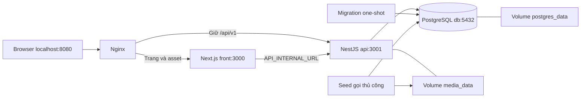

# Thực hành Docker → Nginx → CI/CD → AWS

Soạn **17/11/2026**, hoàn tất kiểm tra **18/11/2026**. Hướng dẫn dành cho website hiện tại, bằng PowerShell tại `D:\Cursor\E-Commerce`. Mục tiêu phát hành vẫn là [giới thiệu/trải nghiệm công khai, chưa nhận đơn thật](RELEASE_PLAN.md). Bộ Compose ở đây là **lab local**, không phải cấu hình để đưa nguyên lên Internet.

## 1. Mục tiêu của bài đầu

Từ mã nguồn, tạo image Linux cho Next.js/NestJS; khởi động chúng với PostgreSQL riêng; nhận request qua Nginx tại **http://localhost:8080**. Database development hiện có và server 3000/3001 vẫn độc lập.



Chỉ Nginx publish cổng lên host, bind vào `127.0.0.1`. Không publish cổng DB/API/FE. Đường dẫn API vẫn `/api/v1`; không sửa controller để phù hợp proxy.

## 2. Kiến thức nền

| Khái niệm | Hiểu trong dự án |
| --- | --- |
| Image | Gói ứng dụng đã build, gồm runtime/dependency/artifact Linux |
| Container | Một lần chạy từ image với env/network/volume cụ thể |
| Dockerfile | Công thức tạo image; thay file chưa tự cập nhật container |
| Compose | Khai báo các service và quan hệ khởi động trên một máy |
| Network/DNS | `api`, `front`, `db` là tên service nội bộ, không phải domain browser |
| Volume | Nơi giữ DB/ảnh qua việc thay container; không thay thế backup |
| Health check | Phân biệt đã chạy tiến trình với đã sẵn sàng nhận request |
| Migration | Áp thay đổi cấu trúc DB đã review, chạy bằng job riêng |
| Seed | Thêm dữ liệu demo; không phải migration và không tự chạy lúc boot API |

Trong container, `localhost` là chính container đó. Vì vậy API dùng `db:5432`, server Next dùng `http://api:3001`; browser dùng `http://localhost:8080/api/v1`. `API_INTERNAL_URL` **không kèm `/api/v1`**, vì mã FE tự nối prefix.

## 3. File đã chuẩn bị và trách nhiệm

| File | Chức năng |
| --- | --- |
| [api/Dockerfile](../api/Dockerfile) | Cài dependencies, generate Prisma v2, build Nest, tạo runtime và target tools |
| [front/Dockerfile](../front/Dockerfile) | Build Next standalone, giữ public/static, chạy bằng `node server.js` |
| [compose.yaml](../compose.yaml) | DB, migrate, API, front, Nginx và profile seed local |
| [Nginx config](../infra/nginx/default.conf) | Routing, forwarded headers, Docker DNS và streaming |
| [init-docker-env.mjs](../infra/scripts/init-docker-env.mjs) | Sinh `.env.docker` ngẫu nhiên, không ghi đè hoặc in secret |
| [smoke-docker.mjs](../infra/scripts/smoke-docker.mjs) | Kiểm kết nối qua Nginx, catalog, HTML, media và Origin guard |
| [CI workflow](../.github/workflows/ci.yml) | Kiểm ứng dụng và stack Docker trên runner Linux |
| [.nvmrc](../.nvmrc) | Pin Node 24.19.0 cho host/CI; Docker dùng cùng patch và pin digest |

Hai `.dockerignore` loại `.env*`, `.npmrc`, node_modules/cache/generated từ host khỏi context build. Root `.gitignore` giữ `.env.docker` ngoài Git; `.env.docker.example` chỉ mô tả contract.

## 4. Chuẩn bị trên Windows

Docker Desktop cần chạy ở chế độ **Linux containers**. Kiểm tra:

```powershell
Set-Location D:\Cursor\E-Commerce
docker version
docker compose version
node --version
```

`docker version` cần có cả Client và Server. Nếu chỉ có Client và lỗi pipe `dockerDesktopLinuxEngine`, mở Docker Desktop hoặc chạy:

```powershell
docker desktop start --detach
```

Chờ engine sẵn sàng rồi kiểm lại. Nếu Docker báo thiếu WSL/virtualization, làm theo hướng dẫn cài đặt Docker Desktop dành cho máy của bạn; không sửa Compose để vượt điều kiện hệ thống. Node baseline là 24.19.0; dependencies backend hiện yêu cầu patch mới của dòng 24, không lấy ngẫu nhiên `node:20` hoặc `node:24` cũ.

## 5. Sinh cấu hình local

```powershell
node infra/scripts/init-docker-env.mjs
docker compose --env-file .env.docker config --quiet
```

Lệnh đầu sinh password DB và hai JWT secret riêng vào `.env.docker`; không dùng hay sửa `api/.env`. Chạy lại giữ nguyên file. Đừng đưa nội dung file vào chat, log hoặc Git. Dùng `config --quiet` để kiểm cấu hình mà không in env đã resolve.

Port mặc định 8080. Nếu port bận, sửa **chỉ `APP_PORT`** trong `.env.docker`, ví dụ 8081; Compose tự điều chỉnh URL/allowed origins. Không thay password DB đã khởi tạo chỉ bằng cách sửa file: PostgreSQL giữ credential trong volume, cần quy trình đổi password đồng bộ hoặc một DB lab mới có chủ đích.

## 6. Build và chạy

```powershell
docker compose --env-file .env.docker up -d --build --wait --wait-timeout 180
docker compose --env-file .env.docker ps -a
```

Luồng: build image → DB healthy → job `migrate` áp history dành riêng cho DB mới → API readiness → Next → Nginx. `migrate` có trạng thái **Exited (0)** là bình thường; nó không phải server chạy mãi. Lần đầu tải image/npm có thể lâu, lần sau có layer cache. `--wait` chỉ thành công khi các service dài hạn healthy.

**Điểm riêng của repository:** kiểm thực tế từ DB rỗng phát hiện migration lịch sử `20261028024109_rename_payment_amout_to_amount` tham chiếu cột `amout` không tồn tại sau migration init. Không sửa SQL/checksum đã áp trên DB hiện hữu. Target tools dùng [prisma.docker.config.ts](../api/prisma.docker.config.ts) và history được tạo khi build từ baseline v2 canonical + các migration sau mốc upgrade v2. Hiện có **hai migration mới-DB**: baseline v2 và saved builds. [Script ghép history](../api/scripts/prepare-docker-migrations.cjs) sao chép SQL nguyên byte từ nguồn, không chạy DB; migration tương lai sau mốc cutover được đưa vào theo thứ tự. Không đổi config của database hiện hữu sang history này; việc sửa/chuẩn hóa legacy history là nhiệm vụ riêng.

[Preflight](../api/scripts/migrate-docker.cjs) từ chối DB có bảng nhưng chưa có history phù hợp, history legacy/trộn legacy hoặc baseline chưa hoàn tất/đã rollback. Nếu thấy `FRESH_DOCKER_HISTORY_REQUIRED` hoặc `EMPTY_DOCKER_DATABASE_REQUIRED`, dừng và xác minh DB đích; không reset hoặc tự đánh dấu migration applied để bỏ qua guard. Guard không thay thế backup hay phân quyền DB.

Kiểm chưa có dữ liệu demo vẫn phải phân biệt với lỗi kết nối. Để nạp dữ liệu mẫu vào **chỉ DB Docker mới**:

```powershell
docker compose --env-file .env.docker --profile tools run --rm seed
```

Job seed dùng ảnh trong `front/public/images` mount read-only rồi ghi bản media vào volume của API, seed role/permission và catalog từ nguồn đã có. Không reset/truncate DB host, không seed tài khoản ADMIN công khai, không gọi Stripe. Seed được thiết kế chạy lại không nhân đôi dữ liệu/tồn; kiểm kết quả thực tế trước khi áp dụng cho dữ liệu cần giữ.

Mở **http://localhost:8080** rồi chạy:

```powershell
node infra/scripts/smoke-docker.mjs
```

Nếu đã đổi port:

```powershell
$env:DOCKER_BASE_URL = 'http://localhost:8081'
node infra/scripts/smoke-docker.mjs
```

Smoke kiểm API/DB ready, có sản phẩm seed, ba route HTML, ảnh media, Origin sai bị từ chối và request phiên không cookie trả 401. Đây chưa phải E2E browser/đặt đơn/thanh toán.

## 7. Tại sao Dockerfile chia nhiều stage?

Stage `dependencies` cài từ lockfile; `build` biên dịch; `runtime` chỉ nhận artifact và dependency chạy. Không chuyển node_modules/generated client từ Windows sang Linux. [Docker multi-stage](https://docs.docker.com/build/building/multi-stage/).

Backend giữ `dist`, `generated/prisma-v2` và hai script tìm entrypoint đúng cấu trúc import. Base image có OpenSSL/CA cho Prisma. Hook `prisma skills sync` bị bỏ **chỉ trong bản package bên trong image**, vẫn cho dependency chạy lifecycle scripts. Target `tools` thêm schema/config/migrations/seed; API không tự migrate mỗi lần khởi động. Prisma hiện là production dependency nên CLI vẫn có trong runtime; tách CLI khỏi runtime sâu hơn là tối ưu sau, chưa cần đổi dependency toàn dự án.

Frontend bật standalone bằng `NEXT_OUTPUT=standalone` riêng cho Docker, output `.next-docker`, giữ cả `.next-docker/static` và `public`. Dev/build Windows vẫn dùng output hiện tại. Cấu hình PostCSS có bản nằm trong `front/` để build độc lập, không phụ thuộc file root ngoài context. Trước sửa tiếp phải đọc hướng dẫn Next cục bộ theo `front/AGENTS.md`.

Image nền được pin tag/digest đã kiểm tra registry tại thời điểm tạo cấu hình. Khi cập nhật Node/Postgres/Nginx, review và kiểm lại rồi thay pin; không tự nâng major hoặc cho rằng pin vĩnh viễn là đủ an toàn. PostgreSQL **17** ở đây là baseline lab được chọn, không khẳng định đó là major DB host hoặc RDS cuối cùng.

## 8. Nginx và bảo mật trong bài local

Nginx chuyển nguyên URI `/api/...` đến API, chuyển phần còn lại sang Next; `Host` giữ port để origin local đúng. Docker DNS được resolve lại khi recreate upstream; không cần restart toàn stack chỉ vì API đổi IP. Tắt buffering trên frontend để giữ streaming, chưa bật proxy cache HTML/API. [Nginx proxy module](https://nginx.org/en/docs/http/ngx_http_proxy_module.html).

Nginx ghi đè `X-Forwarded-For` bằng IP kết nối, API bật `TRUST_PROXY_HOPS=1` cho topology này; host/dev mặc định 0. API không publish port host nên client bên ngoài không đi đường ngắn bỏ proxy. Nếu thêm ALB/CDN hoặc topology khác phải thiết kế lại trust boundary và kiểm IP/rate limit; không tăng hop tùy ý. [NestJS rate limiting sau proxy](https://docs.nestjs.com/security/rate-limiting).

**Giới hạn có chủ đích:** API lab dùng `NODE_ENV=development` để thực hành HTTP/cookie local, nhưng chạy mã đã biên dịch; FE chạy production standalone. Đây không phải cấu hình production bảo mật hoàn chỉnh. Stripe bị tắt rõ ràng; email vẫn adapter local. Không đổi staging/AWS thành development để né yêu cầu HTTPS/email. Trước phát hành công khai còn cần server-side demo restriction, TLS, secret/DB role riêng và checklist [RELEASE_PLAN](RELEASE_PLAN.md).

Nếu mở đồng thời dev `localhost:3000` và Docker `localhost:8080`, cookie cùng hostname/path có thể ghi đè nhau vì cookie không tách theo port. Dùng profile/private window riêng hoặc mở Docker bằng **http://127.0.0.1:8080** (đã allowlist) để giữ phiên localhost của dev; không đổi tên cookie nghiệp vụ chỉ để giải quyết bài lab.

`depends_on` được gắn với health hoặc job hoàn tất; bản thân trạng thái container running chưa đủ để DB nhận truy vấn. Health status cũng không tự làm Docker restart một container bị unhealthy. [Compose startup order](https://docs.docker.com/compose/how-tos/startup-order/).

## 9. Lệnh dùng hằng ngày

```powershell
# Xem trạng thái và log, không in cấu hình chứa secret.
docker compose --env-file .env.docker ps -a
docker compose --env-file .env.docker logs --tail 60 api front nginx migrate

# Sau khi sửa code: build lại và thay container tương ứng.
docker compose --env-file .env.docker up -d --build --wait --wait-timeout 180

# Kiểm cấu hình Nginx trước khi reload.
docker compose --env-file .env.docker exec nginx nginx -t

# Dừng stack, giữ DB/ảnh trong named volume.
docker compose --env-file .env.docker down

# Chạy lại, tái sử dụng dữ liệu.
docker compose --env-file .env.docker up -d --wait --wait-timeout 180
```

Đừng dùng `down -v` hoặc prune volume khi muốn giữ dữ liệu. `restart` chỉ khởi động lại tiến trình, không build code hoặc áp env mới. Khi sửa env/Compose cần `up -d` để recreate phù hợp. Volume sống qua recreate nhưng vẫn mất nếu ổ đĩa/host hỏng; trước AWS phải có backup/restore.

### Khi 3000 đã mới nhưng 8080 vẫn cũ

`3000` là server development trên host; `8080` đi qua Nginx tới frontend đã đóng gói trong image Docker. Frontend Docker không mount source nên không tự cập nhật khi sửa file. Ngay cả khi tag image đã mới, container đang chạy vẫn giữ image cũ đến khi được recreate; chỉ `restart` chưa đủ.

Nếu chỉ sửa frontend, chạy tại root để cập nhật riêng frontend local:

```powershell
docker compose --env-file .env.docker -f compose.yaml build front
docker compose --env-file .env.docker -f compose.yaml up -d --no-deps --no-build --wait --wait-timeout 180 front
node infra/scripts/smoke-docker.mjs
```

Lệnh này không recreate API/DB hoặc chạy migration/seed. Nginx tự phân giải lại địa chỉ frontend qua Docker DNS (cache tối đa khoảng 10 giây). Sau khi frontend healthy, tải lại trang; tab đang mở từ trước có thể cần `Ctrl+Shift+R` để lấy bundle mới. Quy trình này dành cho lab local, không dùng thay quy trình phát hành AWS.

Nếu 502: xem API/front healthy chưa và `nginx -t`; nếu UI báo Origin: URL browser phải khớp allowed origins/port; nếu catalog rỗng: kiểm seed đã chạy thành công; nếu ảnh 404: kiểm media volume và seed mount; nếu login/reset bị giới hạn: đọc chính sách email hiện tại, không coi container chạy là auth production đã nghiệm thu.

## 10. CI trước, CD sau

[Workflow CI](../.github/workflows/ci.yml) chạy khi PR, push nhánh main/master/develop hoặc dispatch thủ công. `application` cài lockfile, generate Prisma, lint/build/unit backend và lint/format/build frontend. `docker` build image, migrate DB rỗng trong runner, seed rồi smoke qua Nginx. Job `required` tổng hợp kết quả để dùng cho branch protection; docs-only bỏ các job ứng dụng/DB và vẫn có kết luận. Job hạ tầng dùng credential sinh tạm, không cần AWS secret.

Workflow **chưa chạy trên GitHub chỉ vì file tồn tại**. Khi bạn yêu cầu push, đưa đúng file vào PR rồi xem Actions; đặt `CI / required` làm check bắt buộc sau khi xác nhận tên check thực tế. Trước phát hành còn bổ sung bộ E2E có đăng nhập/API thật và scan theo yêu cầu release; smoke hiện tại không thay thế chúng.

CD được làm sau khi CI xanh và có môi trường AWS cụ thể: commit đã kiểm → build image một lần → ECR/digest → release manifest/config → staging → smoke → promote bản đã kiểm. Dùng [GitHub OIDC với AWS](https://docs.github.com/en/actions/how-tos/secure-your-work/security-harden-deployments/oidc-in-aws) để cấp quyền tạm thời, giới hạn repo/branch/environment; không lưu access key dài hạn hoặc SSH key vào workflow khi không cần.

## 11. Thay gì khi chuyển lên AWS?

| Local đang có | AWS dự kiến | Điều kiện trước khi làm |
| --- | --- | --- |
| PostgreSQL Compose + local credential | RDS private, TLS và role migration/runtime tách biệt | Chốt major/region/backup, test migration và restore |
| Nginx HTTP `localhost:8080` | Domain/HTTPS, gia hạn certificate và cấu hình production | Chốt domain; cookie Secure, Origin, redirect và forwarded headers đã test |
| Image tag `:local` | ECR + image digest + release config | Build Linux/CI đạt; giữ bản rollback, không build app trên EC2 |
| `.env.docker` | Parameter Store/secret store + IAM role | Secret theo môi trường, không copy file local lên cloud |
| Một stack trên Docker Desktop | EC2 Linux + Compose, SSM quản trị/deploy | Budget, AMI, SG, Docker boot/reboot và log collection |
| Media local named volume | Volume bền + backup hoặc S3 media khi cần | Thử recreate/restore, không làm mất file sau deploy |
| Log rotation local | CloudWatch retention/alarms và probe ngoài host | Kiểm log không lộ dữ liệu, gửi cảnh báo thử |

Nguồn thiết kế: [DEPLOYMENT_PLAN.md](DEPLOYMENT_PLAN.md). Cập nhật 18/11: đã có production Compose/HTTPS, workflow release/deploy và CloudFormation không hardcode tài khoản. Xem [hướng dẫn tổng thể](INFRASTRUCTURE_GUIDE.md) và [AWS foundation](../infra/aws/README.md). Chưa commit/push/provision/deploy; account/domain/region/ngân sách vẫn cần chốt trước tạo tài nguyên.

## 12. Tiêu chí hoàn thành bài thực hành

- Tự giải thích đường đi browser → Nginx → FE/API → DB và hai volume.
- Build từ Linux sạch; Prisma client và Next static assets có trong image.
- Migration từ DB Docker rỗng thành công; seed riêng có ảnh/sản phẩm, không đụng DB host.
- API/front/Nginx healthy, smoke đạt; browser đọc được catalog ở 8080.
- Recreate API/front không mất catalog/ảnh; `down` không xóa volume.
- Nhận biết ranh giới: HTTPS/preview/DB TLS/restore đã có bài kiểm production local riêng; CI trên GitHub, CD và AWS thật vẫn chưa được nghiệm thu.

Kết quả thực tế của lượt tích hợp được ghi tại [PROJECT_STATUS.md](PROJECT_STATUS.md) và [bằng chứng Docker ngày 18/11](verification/2026-11-18-docker.json): build Linux/22 unit/8 browser smoke và kiểm recreate giữ catalog + ảnh mẫu đã qua. Không mặc định các tiêu chí cloud/HTTPS/backup hoặc luồng có tài khoản đã đạt chỉ từ nội dung hướng dẫn này.

Cập nhật 18/11/2026: bài kiểm `node infra/scripts/check-production.mjs` đã bổ sung production HTTPS, preview chỉ đọc, DB role riêng/TLS, CA sai, restore sang DB/volume khác và recreate. Xem [bằng chứng mới](verification/2026-11-18-production-local.json); kết quả lab HTTP ở trên vẫn là mốc lịch sử riêng. [INFRASTRUCTURE_GUIDE](INFRASTRUCTURE_GUIDE.md) giải thích chi tiết từng thành phần, CI/CD và cách chuẩn bị AWS.
