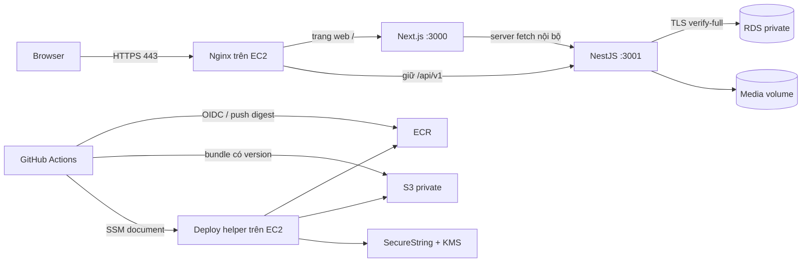

# Hướng dẫn tổng thể Docker, Nginx, CI/CD và AWS

Cập nhật **18/11/2026**. Phạm vi đã chốt: website công khai để giới thiệu/trải nghiệm, **chưa nhận đơn thật**. Chủ dự án chưa có AWS account/domain; hiện hoàn thiện local, định nghĩa pipeline và bộ triển khai có thể review trước. Không có tài nguyên AWS nào được tạo từ công việc này.

Đọc theo thứ tự: [bài Docker thực hành](DOCKER_GUIDE.md) → tài liệu này → [AWS foundation](../infra/aws/README.md) → [runbook helper](../infra/deploy/README.md). [DEPLOYMENT_PLAN](DEPLOYMENT_PLAN.md) lưu quyết định kiến trúc; [PROJECT_STATUS](PROJECT_STATUS.md) và [bằng chứng production local](verification/2026-11-18-production-local.json) lưu kết quả thật.

## 1. Mục tiêu và tiêu chí hoàn thành

Mã frontend/backend đã có nghiệp vụ. Lớp hạ tầng bổ sung cách đóng gói, chạy nhất quán, kiểm tra trước phát hành và vận hành có thể truy vết. Công khai một bản giới thiệu không cần bật thu tiền hay nhận dữ liệu khách hàng.

- Local: một lệnh Compose dựng các dịch vụ; DB/ảnh có volume riêng; không đụng `api/.env` hay database đang phát triển.
- Production rehearsal: chạy artifact FE/BE thực sự ở production sau HTTPS, DB xác minh CA/hostname, app chỉ có quyền SELECT; thử backup/restore và thay container.
- CI: kiểm source, build Linux, dựng database mới, migration, seed mẫu và smoke qua Nginx; kiểm tĩnh template AWS/scripts/workflows.
- CD kit: build/push image bất biến, bundle có manifest/checksum/version; deploy qua SSM, kiểm health, có quy tắc rollback.
- AWS: template và runbook sẵn để review. Provision, OIDC thật, ACME, restore/reboot EC2 và nghiệm thu cloud vẫn cần làm khi có account/domain/ngân sách.

## 2. Mỗi thành phần chịu trách nhiệm gì?

| Thành phần | Việc đảm nhận | Không nên giao việc gì cho nó |
| --- | --- | --- |
| Next.js frontend | Render giao diện, lấy snapshot storefront từ API, xử lý tương tác trình duyệt | Giữ secret DB/Stripe hoặc quyết định giá/tồn kho cuối cùng |
| NestJS backend | Kiểm DTO, phân quyền, nghiệp vụ, truy vấn DB, phục vụ media; áp chốt preview ở HTTP | Tự chạy migration mỗi lần khởi động hoặc tự cấp certificate |
| PostgreSQL | Lưu dữ liệu, constraint/transaction, quyền DB | Chỉ dựa vào frontend để bảo vệ dữ liệu |
| Prisma | Generate client v2 và áp migration có lịch sử | Sửa checksum migration cũ để ép DB hiện hữu qua lỗi |
| Dockerfile | Tạo image chứa runtime và artifact đúng phiên bản | Chứa secret, DB hay dữ liệu người dùng bên trong layer |
| Docker Compose | Ghép dịch vụ/network/volume, healthcheck và restart policy trên một host | Điều phối nhiều máy hoặc bảo đảm không downtime |
| Nginx | Điểm vào HTTP/HTTPS, định tuyến FE/API, đặt proxy header, phục vụ ACME challenge | Chứa business logic đặt hàng hoặc thay route guard của API |
| GitHub Actions CI | Chặn mã lỗi bằng lint/build/test và kiểm tích hợp Docker | Dùng DB thật hay có quyền đọc secret production |
| GitHub Actions Release | Build/push ECR, ghi bundle S3 và metadata phiên bản | SSH vào host, đọc runtime env hoặc dùng master DB |
| GitHub Actions Deploy | Gửi đúng SSM document và theo dõi kết quả cuối | Chạy shell tùy ý nhận từ input người dùng |
| EC2 | Máy Linux chạy Docker/Nginx/FE/BE và lưu media volume | Build ứng dụng trong lúc phục vụ khách |
| RDS PostgreSQL | Database private, encryption, backup có quản lý | Public port 5432 ra Internet |
| ECR | Lưu image API, frontend và tools | Lưu file `.env` hay thay nội dung tag cũ |
| S3 versioned release | Lưu bundle cấu hình không secret, giữ version/checksum để phát hành lại | Public hosting cho secret/runtime env |
| IAM + OIDC | Cấp quyền AWS ngắn hạn và giới hạn đúng job/tài nguyên | Dùng access key lâu dài trong GitHub secret |
| SSM | Quản trị host và gọi quy trình phát hành được giới hạn | Mở cổng SSH hay nhận password trong tham số Run Command |
| Parameter Store + KMS | Cất hai SecureString runtime/migration tách môi trường | Đưa secret vào CloudFormation Outputs hoặc frontend |
| Certbot | Xin/gia hạn chứng chỉ từ ACME qua webroot | Tự tạo chứng chỉ public khi domain chưa trỏ đúng |
| CloudWatch/Budget | Log, metric, cảnh báo tài nguyên và chi phí | Bảo đảm mọi lỗi đều tự khắc phục hoặc tự ngắt chi phí |

**Image** là gói chỉ đọc; **container** là một tiến trình chạy từ gói đó. **Volume** lưu dữ liệu độc lập vòng đời container. **Digest** là hash nội dung image; khác tag có thể dịch chuyển. **Migration** là thay đổi schema có thứ tự. **CI** kiểm trước khi nhận mã; **CD** đưa bản đã kiểm sang môi trường chạy.

## 3. Kiến trúc và đường đi của một yêu cầu



Ví dụ mở `/products`: browser đến Nginx, Nginx chuyển Next.js, server Next gọi `http://api:3001/api/v1/storefront`, API SELECT dữ liệu rồi trả snapshot, Next render HTML. Ảnh API đi qua `/api/v1/media/<id>`. Browser dùng cùng origin `/api/v1`, giảm cấu hình CORS/cookie giữa hai domain.

`API_INTERNAL_URL=http://api:3001` là **origin**, không thêm `/api/v1`; FE client đã tự ghép prefix. Nginx giữ nguyên prefix khi proxy. Host nội bộ `api`, `front` là DNS dịch vụ Docker, không phải domain công khai. Chỉ Nginx publish port; không publish 3000/3001 trên production.

API chỉ trust đúng **một** proxy trong topology này; Nginx thay forwarded headers bằng giá trị nó kiểm soát. Thêm ALB/CDN sau này cần thiết kế lại chuỗi proxy trước khi đổi `TRUST_PROXY_HOPS`.

## 4. Tách môi trường như thế nào?

| Môi trường | Cấu hình | DB/secret | Mục đích |
| --- | --- | --- | --- |
| Dev hiện có | npm trong `api/`, `front/` | Cấu hình dev riêng | Viết code, HMR; tiếp tục dùng như trước |
| Docker lab | `compose.yaml` + `.env.docker` | DB/volume Docker riêng | Học Compose/Nginx HTTP tại `http://localhost:8080` |
| Production local test | `compose.deploy.yaml` + override tạm do script sinh | DB TLS/CA/password riêng mỗi lần, xóa sau test | Chạy production HTTPS tại localhost 8443 trong lúc test |
| CI | Runner Ubuntu tạm thời | Dữ liệu giả; không secret AWS ở CI | Kiểm Linux/build/migration/restore |
| AWS staging | `compose.deploy.yaml` + `compose.aws.yaml` | RDS, KMS, SecureString và volumes riêng | Diễn tập deployment trước công khai |
| AWS demo | Stack riêng cùng contract | Không dùng chung DB/secret staging | Website giới thiệu công khai khi nghiệm thu |

Docker lab dùng API `development` để cookie/Origin phù hợp HTTP local; đó không phải cấu hình mang lên AWS. Production Compose cố định `NODE_ENV=production`, `PREVIEW_READ_ONLY=true`, DB TLS, Stripe keys rỗng. Không đổi production thành development để né lỗi HTTPS.

## 5. Đã tạo bộ file này bằng cách nào?

1. Đọc package/lockfile, đường dẫn Prisma v2, build wrapper và cách FE gọi API thực tế. Pin Node theo dependency đang dùng, không chọn từ trí nhớ.
2. Tách Dockerfile thành dependency/build/runtime/tools. Build generate Prisma v2 trước Nest; FE tạo Next standalone và mang đủ `public` + static assets vào runtime.
3. Chỉ copy file cần cho build bằng `.dockerignore`. Secret, node_modules Windows, cache Next và tài liệu AI không vào build context. API/FE runtime chạy UID 1000.
4. Dùng Compose nối network và healthcheck. Migration là job kết thúc rồi mới mở API; seed là thao tác riêng. Named volumes giữ DB và media khi thay container.
5. Thêm Nginx HTTP cho lab; thêm template HTTPS riêng cho production, chặn Swagger và readiness nội bộ ở edge.
6. Giải quyết clean bootstrap của migration: giữ nguyên history cũ, tạo track riêng cho **DB Docker/AWS mới từ rỗng** từ baseline v2 và SQL sau cutover. Không dùng track này cho DB dev hiện hữu.
7. Thêm chốt preview server/FE và DB role chỉ đọc để phù hợp phạm vi public showcase. Bản local dev mặc định vẫn theo cấu hình hiện có.
8. Tự động hóa smoke/restore/CA-negative tests, sau đó đưa cùng bước vào CI. Viết release manifest, workflows, helpers và CloudFormation theo cùng contract.

## 6. File nào làm việc gì?

| File/thư mục | Vai trò cụ thể |
| --- | --- |
| [api/Dockerfile](../api/Dockerfile), [front/Dockerfile](../front/Dockerfile) | Build artifact và tách runtime/tools |
| [compose.yaml](../compose.yaml) | Stack lab có PostgreSQL local, migrate, seed, API/FE/Nginx |
| [compose.deploy.yaml](../compose.deploy.yaml) | Stack production không chứa DB, chỉ nhận ECR digest và file env ngoài repo |
| [compose.aws.yaml](../compose.aws.yaml) | Đổi logging sang CloudWatch; chỉ dùng trên host có IAM phù hợp |
| [infra/nginx](../infra/nginx) | HTTP lab, ACME-only và HTTPS production |
| [init-docker-env.mjs](../infra/scripts/init-docker-env.mjs) | Sinh secret lab ngẫu nhiên, không ghi đè file đã có |
| [smoke-docker.mjs](../infra/scripts/smoke-docker.mjs) | Kiểm FE/API/ảnh/Origin qua Nginx local |
| [check-production.mjs](../infra/scripts/check-production.mjs) | Dựng DB TLS riêng, role riêng, kiểm preview, CA sai, restore và container persistence |
| [setup-db-roles.cjs](../api/scripts/setup-db-roles.cjs) | Operator tạo role migration/runtime trên DB trống; từ chối role trùng/DB có bảng |
| [migrate-docker.cjs](../api/scripts/migrate-docker.cjs) | Kiểm history và TLS rồi gọi Prisma migrate deploy |
| [package-release.mjs](../infra/scripts/package-release.mjs) | Tính fingerprint schema; đóng bundle không secret và manifest |
| [publish-release.sh](../infra/scripts/publish-release.sh) | Build/push images, resolve digest, upload bundle S3 có version |
| [deploy-ssm.sh](../infra/scripts/deploy-ssm.sh) | Truyền input JSON giới hạn cho SSM, poll kết quả |
| [infra/deploy](../infra/deploy) | Lấy env, prepare/deploy/rollback app, certificate và seed mẫu có chủ đích |
| [infra/aws](../infra/aws) | Template CloudFormation, bootstrap host, tham số mẫu và hướng dẫn provision sau này |
| [.github/workflows](../.github/workflows) | CI, Release AWS, Deploy AWS |

## 7. Chạy và kiểm tra ngay trên máy của bạn

PowerShell tại root, Docker Desktop ở chế độ Linux containers:

```powershell
node infra/scripts/init-docker-env.mjs
docker compose --env-file .env.docker up --detach --build --wait --wait-timeout 180
docker compose --env-file .env.docker --profile tools run --rm seed
node infra/scripts/smoke-docker.mjs
```

Nếu `.env.docker` đã có thì bỏ bước sinh file. Mở `http://localhost:8080`. Sau khi sửa code, build/up lại dịch vụ liên quan theo [DOCKER_GUIDE](DOCKER_GUIDE.md). Không chạy `down --volumes` trên lab cần giữ dữ liệu.

Kiểm production độc lập sau khi build ba image local:

```powershell
node infra/scripts/check-production.mjs
```

Script tạo project Docker ngẫu nhiên, database/CA/password tạm; không đọc `api/.env`. Nó chỉ xóa containers/volumes của project kiểm thử đó. Report JSON được ghi vào thư mục temp và in đường dẫn. 8081/8443 cần trống; không đổi hoặc dừng server khác để giành port. Chứng chỉ test chỉ tồn tại trong test, không dùng cho public domain.

Để kiểm thêm Chromium nếu `front/node_modules/@playwright/test` và browser đã cài:

```powershell
$env:PRODUCTION_BROWSER_CHECK='1'
node infra/scripts/check-production.mjs
Remove-Item Env:PRODUCTION_BROWSER_CHECK
```

Node HTTPS trong test xác minh CA thật; riêng Chromium được cho phép CA test local để kiểm UI. Chế độ này không thay cấu hình xác minh TLS trên app/public deployment.

## 8. Preview chặn đặt hàng như thế nào?

`PREVIEW_READ_ONLY=true` bật middleware trước controller. Chỉ allowlist public GET/HEAD cho catalog/storefront/media/health; private routes không trả dữ liệu tài khoản, các mutation trả `503 PREVIEW_READ_ONLY`, session trả 401. Không dựa vào việc ẩn nút trên FE. Stripe gateway bị tắt nên recovery worker không khởi chạy.

FE đọc flag ở server runtime, hiện banner dữ liệu minh họa, không bootstrap session/cart account, trang login không có form thu mật khẩu. Các tương tác catalog/so sánh/xem cấu hình vẫn phục vụ trải nghiệm; hành động cần tài khoản báo trạng thái preview.

Role `rigforce_app` chỉ CONNECT/USAGE/SELECT; role `rigforce_migrate` riêng được tạo bảng. `ALTER DEFAULT PRIVILEGES` cấp SELECT cả bảng tạo về sau bởi migration role. Nếu sau này bật tài khoản/đơn hàng, cần một mốc thiết kế quyền/PII/rate limit/email/nghiệp vụ và kiểm thử mới; không chỉ gỡ banner.

## 9. CI chạy những gì?

`ci.yml` chạy trên PR, push main/master/develop, manual và reusable call từ Release. Nó không nhận runtime secret AWS.

1. `changes` phân loại thay đổi. Tài liệu thuần có thể skip job app/Docker/infra; thay Compose/Docker/scripts/.nvmrc phải chạy kiểm tra.
2. `application`: npm ci đúng hai lockfile, Prisma generate → API lint/build/31 unit tests; FE lint/format/build; manifest contract tests.
3. `docker`: dựng lab từ DB mới, seed/smoke; dựng production TLS riêng, kiểm SELECT-only/CA sai/restore/thay container; cleanup tài nguyên test.
4. `infrastructure`: cfn-lint CloudFormation, Bash syntax và ShellCheck. Template hợp lệ tĩnh chưa chứng minh quyền IAM/quotas/AMI ở account thật.
5. `required`: chỉ thành công khi mọi job bắt buộc thành công hoặc skip hợp lệ; phù hợp đặt required status trong branch protection.

Định nghĩa đã được kiểm ở local; **chưa có run GitHub thật vì chưa commit/push**. Các action được pin full commit SHA. Không dùng `pull_request_target` để chạy code PR với quyền AWS.

## 10. Release khác deploy ở đâu?

**Release** tạo một bản có thể cài đặt. **Deploy** chọn bản đó và đưa lên host.

`release-aws.yml` chỉ chạy manual từ default branch, gọi lại CI cùng commit trước khi lấy quyền AWS. GitHub Environment `staging` hoặc `demo` cấp cấu hình qua Variables; OIDC đổi token GitHub lấy quyền AWS ngắn hạn. [Cơ chế OIDC chính thức](https://docs.github.com/en/actions/how-tos/secure-your-work/security-harden-deployments/oidc-in-aws).

- API repo chứa `api-<fullSHA>` và `tools-<fullSHA>`; FE repo chứa `front-<fullSHA>`. Tags immutable; retry build dùng lại tag đã publish, không ghi đè.
- Manifest ghi commit, ba digest, fingerprint SQL và `migrationPolicy`. Image có label revision/fingerprint để helper đối chiếu.
- Bundle chỉ chứa manifest, Compose, Nginx và operational scripts/units. Checkout bẩn bị từ chối; `--allow-dirty` chỉ đóng fixture local và deploy vẫn từ chối.
- S3 key: `releases/<env>/<fullSHA>/release.tar.gz`. Ghi VersionId và SHA256 vào job summary. Release đã tồn tại không bị thay; deploy lại từ metadata đã ghi.
- `deploy-aws.yml` có thể chạy độc lập với key/version/checksum đã ghi. Nó assume deploy role và gọi **đúng** SSM document, chờ trạng thái cuối.

Không truyền secret qua workflow input/SSM parameters. VersionId là chuỗi opaque có thể chứa `+` hoặc `/`, luôn truyền qua quoted argument/JSON và không dùng làm tên thư mục.

## 11. Chuẩn bị GitHub/AWS khi đã có account

Chưa chạy phần này trong phiên hiện tại. Làm theo [infra/aws/README](../infra/aws/README.md), tạo change set để review trước khi execute.

| GitHub Environment Variable | Lấy từ |
| --- | --- |
| `AWS_REGION` | Region chủ dự án chọn |
| `AWS_RELEASE_ROLE_ARN` | Output `GitHubReleaseRoleArn` |
| `AWS_DEPLOY_ROLE_ARN` | Output `GitHubDeployRoleArn` |
| `API_REPOSITORY_URI` | Output `ApiRepositoryUri` |
| `FRONT_REPOSITORY_URI` | Output `FrontRepositoryUri` |
| `RELEASE_BUCKET` | Output `ReleaseBucketName` |
| `INSTANCE_ID` | Output `InstanceId` |
| `RELEASE_DOCUMENT` | Output `ReleaseDocumentName` |

Không cần AWS access key trong GitHub. Phải đặt branch policy của GitHub Environments trùng default branch và reviewers theo quyền/gói GitHub. Trust `environment:staging` không tự giới hạn branch.

Thứ tự lần đầu: foundation bootstrap bundle → CFN change set/resources → kiểm SSM/logs và GitHub Variables → Release **chưa deploy** để có tools image → operator setup DB roles → tạo hai SecureString → `apply-release.sh --prepare` → DNS/ACME → seed mẫu có chủ đích nếu cần → Deploy → smoke/rollback/reboot/restore → mở công khai. Chọn `backward-compatible` cho phát hành schema đầu tiên sau review; `none` chỉ khi schema đã được ghi nhận và không đổi.

### Các thao tác operator đầu tiên trên host

Phần này dành cho **Linux EC2 đã được provision**, không chạy trên máy dev hiện tại. Đọc đầy đủ AWS README trước; `TOOLS_IMAGE` lấy đúng digest trong Release job summary. Operator chuẩn bị `/private/roles.env` mode 0600 ngoài repo gồm `DB_ADMIN_URL`, `MIGRATION_PASSWORD`, `RUNTIME_PASSWORD`. URL master lấy bằng quyền operator, dùng endpoint RDS và TLS CA đã bootstrap; hai password dài tối thiểu 32 ký tự. Không gửi các giá trị này qua chat, input CI hoặc command-line SQL.

```bash
# Trong một shell root/SSM; TOOLS_IMAGE và AWS_REGION là identifier không secret.
(
  set -eu
  umask 077
  auth_dir=$(mktemp -d)
  trap 'rm -rf -- "$auth_dir"' EXIT
  export DOCKER_CONFIG="$auth_dir"
  registry=${TOOLS_IMAGE%%/*}
  aws ecr get-login-password --region "$AWS_REGION" |
    docker login --username AWS --password-stdin "$registry"
  docker pull "$TOOLS_IMAGE"
  docker run --rm --env-file /private/roles.env \
    -v /opt/rigforce/shared/certs/rds-global-bundle.pem:/run/certs/rds-global-bundle.pem:ro \
    --entrypoint node "$TOOLS_IMAGE" scripts/setup-db-roles.cjs --new-database
)
```

Script từ chối DB có bảng/role trùng, không tự rotate password. Sau khi tạo hai SecureString theo AWS README, chuẩn bị release:

```bash
/opt/rigforce/bin/apply-release.sh --prepare "$RELEASE_KEY" "$RELEASE_VERSION" "$RELEASE_SHA256"
# Gán prepared bằng đường dẫn release mà helper vừa in, không tự đoán hash.
bash "$prepared/infra/deploy/certificate.sh" test-issuance "$ACME_EMAIL" "$prepared"
bash "$prepared/infra/deploy/certificate.sh" issue "$ACME_EMAIL" "$prepared"
# Tùy chọn, chỉ DB/catalog mới và dữ liệu minh họa đã được review:
bash "$prepared/infra/deploy/seed-preview.sh" --new-sample-catalog "$prepared"
```

`test-issuance` dùng ACME staging và thư mục riêng, không tạo certificate được chấp nhận để public. DNS phải trỏ đúng EIP và port 80 truy cập được. Seed lấy ảnh từ **frontend image đã phát hành**, không phụ thuộc checkout source trên EC2; nó tự login ECR bằng config tạm, kiểm catalog rỗng và không được CD tự gọi. Runtime production vẫn chỉ đọc. Khi đã upload xong các credential cần thiết vào SecureString, operator thu hồi/xóa bản master env tạm theo quy trình secret của mình.

Chạy Deploy AWS với metadata release. Sau lần deploy đầu, kiểm dry run gia hạn rồi cài timer:

```bash
bash /opt/rigforce/current/infra/deploy/certificate.sh test-renewal
install -m 0644 /opt/rigforce/current/infra/deploy/rigforce-certificate.service /etc/systemd/system/
install -m 0644 /opt/rigforce/current/infra/deploy/rigforce-certificate.timer /etc/systemd/system/
systemctl daemon-reload
systemctl enable --now rigforce-certificate.timer
systemctl list-timers rigforce-certificate.timer
```

Các helper trong `/opt/rigforce/bin` được pin từ foundation bundle. Một release chứa bản source helper không tự nâng cấp host entrypoint; thay phiên bản foundation/helpers cần operator review và cài đặt có chủ đích. Cách này tránh một lần phát hành app âm thầm đổi cơ chế deployment.

## 12. Secret, TLS và migration

Runtime và migration dùng hai file env ngoài repo, root mode 0600, tải atomic từ đúng hai SecureString. App không nhận credential migration, CI không đọc master secret. Ví dụ contract tại [runtime.env.example](../infra/deploy/runtime.env.example) và [migration.env.example](../infra/deploy/migration.env.example), không copy placeholder lên host rồi coi là hoàn tất.

RDS yêu cầu TLS ở server; client vẫn phải xác minh CA/hostname. Adapter `pg`/preflight dùng `sslmode=verify-full&sslrootcert=/run/certs/rds-global-bundle.pem`; Prisma CLI dùng URL riêng cùng host/DB/user/password với `sslmode=require&sslaccept=strict&sslcert=...`. Hai client có dialect khác nhau; wrapper kiểm cả hai, test sai CA đã chạy cho cả hai. [RDS SSL](https://docs.aws.amazon.com/AmazonRDS/latest/UserGuide/UsingWithRDS.SSL.html), [node-postgres SSL](https://node-postgres.com/features/ssl).

Migration chỉ chạy one-shot sau khi pull/kiểm image/certificate. Nếu SQL thay đổi, phải review tương thích với app cũ. Rollback image không xóa cột hay khôi phục DB. `maintenance-required` không được auto deploy; cần kế hoạch riêng. History legacy hay DB không rỗng thiếu baseline đều bị từ chối, không reset dữ liệu để ép thành công.

Preflight còn đối chiếu mọi migration đã ghi trong DB với SQL/checksum có trong tools image. History mới hơn image cũ hoặc SQL đã áp bị sửa đều bị chặn. Muốn quay lại app cũ sau khi schema đã tiến lên, dùng quy trình **app-only rollback** đã review; không chạy lại migration image cũ rồi ghi đè schema state thành fingerprint cũ.

## 13. HTTPS, rollback, backup và sự cố

Certificate lần đầu dùng ACME-only Nginx: chỉ phục vụ challenge trên port 80, trả 503 ở đường dẫn khác. Sau khi có cert public hợp lệ mới deploy full app. `certificate.sh` có test-issuance riêng, renew và test-renewal; unit/timer đi kèm chạy kiểm hai lần mỗi ngày rồi kiểm Nginx trước reload. Operator phải cài/enable timer sau lần phát hành đầu; nó không tự được bật khi chưa có host/domain. [Certbot webroot/renewal](https://eff-certbot.readthedocs.io/en/stable/using.html).

Helper dùng khóa `flock` để không deploy/gia hạn/seed đồng thời. Bundle được kiểm SHA/manifest, extract theo allowlist; current/previous được đổi sau khi đủ điều kiện. App deploy lỗi chỉ quay về image cũ khi chính sách schema cho phép; migration lỗi cần review trạng thái, không tự reverse SQL. Xem contract lỗi/khôi phục ở [infra/deploy/README](../infra/deploy/README.md).

RDS template bật backup 7 ngày, encryption và deletion protection. Khi sự cố, restore RDS sang **instance mới**, kiểm dữ liệu rồi mới đổi secret/endpoint; không ghi đè DB đang chạy. Media volume nằm trên EBS EC2: trước thay host, operator dừng writes liên quan, tạo snapshot EBS mã hóa và thử lấy lại media/certificate trên volume khác. Snapshot chứa secret host nên quyền truy cập chỉ operator; không upload vào release artifact. Muốn backup media tự động lên S3 phải thêm bucket/policy/retention và diễn tập riêng, hiện chưa có job đó.

Restore drill local đã dùng `pg_dump -Fc`/`pg_restore` sang DB thứ hai và tar media sang volume khác; so sánh 183 products và hash toàn bộ media. Đây là bằng chứng kỹ thuật local; không thay thế diễn tập RDS snapshot/PITR hay restore EBS trên AWS. Thời gian vài giây của lab không phải cam kết RTO production.

## 14. Ai chịu trách nhiệm khi dự án chỉ có một người?

Một người có thể đảm nhận nhiều vai trò, nhưng mỗi lần thay đổi vẫn cần biết mình đang chịu trách nhiệm lớp nào.

| Vai trò | Trách nhiệm và đầu ra |
| --- | --- |
| Chủ sản phẩm | Chốt showcase/bán thật, nội dung, domain, ngân sách và điều kiện mở công khai |
| Frontend developer | UI, accessibility, trạng thái preview, server/client URL, build/static assets và kiểm browser |
| Backend developer | API contract, auth/ownership, preview boundary, health, shutdown, nghiệp vụ và unit/integration tests |
| Database developer | Schema/migration, role/default privilege, TLS, tương thích khi rollback và kiểm restore |
| Infra/DevOps | Docker/network/Nginx/HTTPS, pipeline, IAM/OIDC/SSM, template AWS, logs/alarms/runbook |
| QA/reviewer | Đối chiếu hành vi đã kiểm, negative tests, lỗi deploy/rollback, bằng chứng và giới hạn |
| Operator | Thực thi provision/deploy được phép, giữ secret, kiểm chi phí/cảnh báo, gia hạn/backup/khôi phục |

AI có thể hỗ trợ viết và kiểm trong phạm vi được giao; chủ dự án vẫn quyết định tài khoản, ngân sách, dữ liệu và thời điểm công khai. Agent không tự push/provision/deploy từ một yêu cầu lập kế hoạch.

## 15. Trade-off và phần còn lại

Baseline một EC2 + Compose dễ học và ít thành phần hơn ECS/ALB/NAT; đổi lại có một điểm lỗi duy nhất, downtime ngắn khi thay container, media gắn host và vận hành certificate cần chăm sóc. RDS tách DB khỏi host app nhưng Single-AZ chưa có HA. Chưa cần Redis/queue/microservices chỉ để tăng số công nghệ.

Trước public cần nghiệm thu ở **AWS staging thật**: OIDC/IAM, bootstrap/SSM, ACME DNS, log/alarms, deploy lỗi/rollback, reboot host và restore DB/media. Chốt quyền ảnh/nội dung/SEO và nhãn minh họa theo [RELEASE_PLAN](RELEASE_PLAN.md). Các chức năng bán thật, Stripe live/refund/giao vận vẫn thuộc mốc sau.
