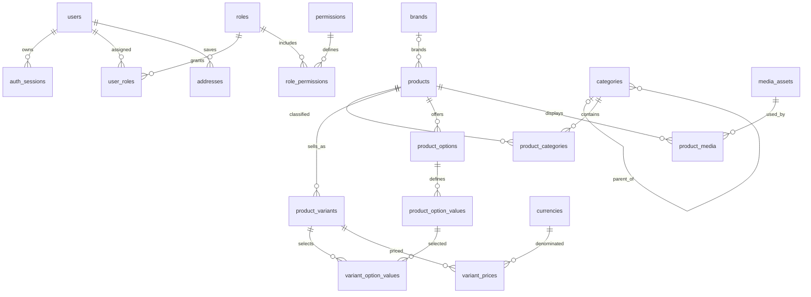
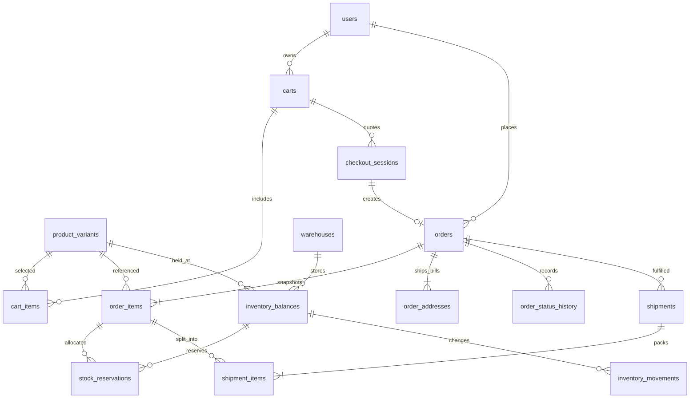
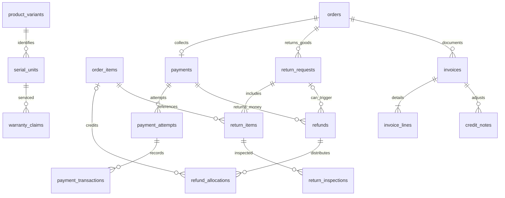
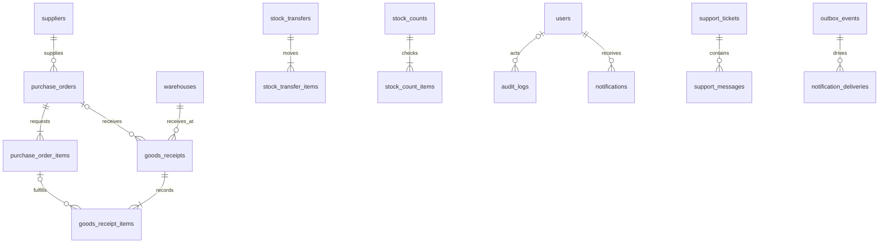

# Thiết kế database E-Commerce v2

Ngày: **05/11/2026**. Trạng thái: **bản thiết kế đề xuất để triển khai**, chưa phải database đang chạy. Yêu cầu thiết kế mở rộng đến từ chủ dự án; các chính sách kinh doanh ghi dưới đây là giả định thiết kế, cần xác nhận bằng acceptance criteria khi cài đặt.

**Cập nhật cùng ngày:** database public đã áp dụng schema v2 102 bảng và backfill tài khoản/catalog/tồn/giỏ sang **VND**, giữ trị số giá, không FX. Đơn/payment cũ không đưa vào public v2; tám bảng nguồn vẫn ở schema `legacy_v1`. API vẫn dùng client/service v1 và cần cập nhật trước khi chạy với public v2. Xem [kết quả migration](PRISMA_V2.md); schema v1 lưu tại [bản đối chiếu](../../api/prisma/archive/schema.v1.prisma.bak).

## Đọc theo thứ tự

1. Tài liệu này: phạm vi, nguyên tắc và sơ đồ quan hệ.
2. [Từ điển dữ liệu](DATA_DICTIONARY.md): bảng, cột, kiểu dữ liệu, khóa và ràng buộc.
3. [Luồng và tính nhất quán](TRANSACTIONS.md): tiền, tồn, trạng thái, đồng thời, retry và SQL minh họa.
4. [Kế hoạch chuyển đổi và nghiệm thu](MIGRATION.md): ánh xạ từ dữ liệu cũ, chia giai đoạn và bằng chứng cần có.
5. [Prisma v2](PRISMA_V2.md): schema đã hiện thực hóa, cách generate/validate và ranh giới với backend v1.

## 1. Phạm vi sản phẩm

Thiết kế cho **một doanh nghiệp tự bán hàng vật lý**, có website bán lẻ và quản trị nội bộ. Hỗ trợ khách đăng nhập, giỏ khách vãng lai, nhiều SKU/biến thể, nhiều kho, nhiều kiện giao, nhiều lần thử thanh toán, hoàn một phần và truy vết vận hành. Đặt hàng yêu cầu tài khoản ở lần triển khai đầu; giỏ khách vãng lai được hợp nhất khi đăng nhập.

Không mặc định đây là sàn nhiều người bán. Supplier là nhà cung cấp hàng cho cửa hàng, không phải seller có gian hàng. Không tự thêm seller settlement, chia hoa hồng, ví điện tử, sổ cái kế toán tổng hợp, payroll, subscription hay sản phẩm số vào lõi bán lẻ. Nếu cần những mô hình đó, phải thiết kế thêm nghiệp vụ riêng.

PC/gaming gear chỉ là ví dụ dữ liệu. Thuộc tính, biến thể, serial và bảo hành không buộc database vào một ngành hàng.

| Nhóm | Mục đích thực tế | Mức triển khai |
| --- | --- | --- |
| Tài khoản, phiên, địa chỉ, phân quyền | Tách phiên theo thiết bị, thu hồi token, quản trị theo nhiệm vụ | Nền tảng |
| Catalog, SKU, media, thuộc tính, giá | Một sản phẩm nhiều SKU; lọc thông số và lưu ảnh có quản lý | Nền tảng |
| Kho, số dư, giữ hàng, sổ biến động | Ngăn bán vượt tồn, giải thích được mỗi thay đổi | Nền tảng, khởi đầu một kho |
| Giỏ, checkout, đơn, snapshot, lịch sử | Giá từ server, đặt lặp không sinh hai đơn, giữ lịch sử mua | Nền tảng |
| Payment, giao dịch, webhook, refund | Phân biệt lần thử với tiền thực thu, xử lý retry và hoàn một phần | Nền tảng |
| Shipping, shipment, tracking | Tính phí và giao từng phần, nhận sự kiện vận chuyển | Shipping cơ bản trước; nhiều kiện sau |
| Promotion, coupon, phân bổ giảm giá | Kiểm soát lượt dùng và hoàn tiền đúng phần đã trả | Mở rộng bán hàng |
| Nhà cung cấp, PO, nhập/chuyển/kiểm kho | Khép kín đường đi của hàng trước và sau khi bán | Mở rộng vận hành |
| Đổi trả, serial, bảo hành | Kiểm tra hàng trả; không nhập hàng hỏng vào tồn bán | Mở rộng hậu mãi |
| Wishlist, review, CMS, hỗ trợ, thông báo | Trải nghiệm và công việc của nhân viên | Mở rộng sản phẩm |
| Audit, idempotency, inbox/outbox, đối soát | Điều tra sự cố và phục hồi khi tích hợp lỗi | Cơ chế tối thiểu đi cùng lõi |
| Hóa đơn thương mại, credit note | Chụp chứng từ nội bộ, điều chỉnh sau hoàn tiền | Mở rộng chứng từ |

Thiết kế rộng để có bản đồ đích; chỉ tạo bảng của một giai đoạn khi service và kiểm thử đi cùng đã sẵn sàng. Mỗi nhóm có lý do nghiệp vụ, không lấy số bảng làm tiêu chí hoàn thành.

## 2. Những thay đổi so với 8 bảng hiện tại

| Hiện tại | Mô hình đích | Lý do |
| --- | --- | --- |
| `User.role`, `refreshToken` | Roles/permissions và nhiều auth session | Nhân viên kho không cần quyền hoàn tiền; đăng xuất riêng thiết bị |
| `Product` giữ cả giá và stock | Product → Variant → Price; Variant × Warehouse → Balance | Nội dung khác đơn vị có thể mua; stock không nằm lẫn trong catalog |
| Một category/product | Cây category và bảng nối product/category | Menu nhiều cấp, sản phẩm xuất hiện ở nhiều danh mục |
| `imageUrl` đơn | Media và bảng nối ảnh | Nhiều ảnh, thứ tự, alt text, trạng thái file |
| Stock là số nguyên có thể sửa | Balance + Reservation + Movement | Có số dư hiện tại và lịch sử nguồn gốc; giữ/trừ/hoàn đúng một lần |
| `checkedOut` và nhiều active cart | Cart status, version, unique có điều kiện | Tránh hai giỏ hoạt động do request đồng thời |
| Request truyền `item.price` | Checkout server tính + order item snapshot | Chặn sửa giá từ browser và giữ lịch sử khi catalog thay đổi |
| Địa chỉ đơn là string | Address book + order address snapshot | Sửa địa chỉ cá nhân không đổi địa chỉ đơn cũ |
| `Order.status` gộp mọi thứ | Order, payment và shipment có trạng thái riêng | Đã trả tiền không có nghĩa đã giao; hủy không có nghĩa đã hoàn tiền |
| Một Payment/order | Payment aggregate → nhiều attempt → nhiều transaction | Retry có dấu vết; tránh nhầm lần gọi API với khoản tiền thực thu |
| Không có refund model | Refund → allocation → provider transaction | Hoàn từng dòng, phí ship, retry và giới hạn tổng tiền |
| Cascade từ user tới giao dịch | Restrict lịch sử, khóa/anonymize tài khoản | Không mất đơn/payment vì xóa tài khoản |

Bằng chứng: schema hiện tại và các service trong `api/src/modules/{auth,carts,orders,payments,products}/`. Đây là rà soát tĩnh; chưa xác nhận dữ liệu database thực tế.

## 3. Nguyên tắc mô hình hóa

**Product và SKU.** Product là trang giới thiệu; variant là đơn vị bán và quản lý tồn. Sản phẩm không có lựa chọn vẫn có một variant mặc định. Cart/order/inventory luôn tham chiếu variant. SKU không tái sử dụng sau khi ngừng bán.

**Chuẩn hóa và snapshot.** Dữ liệu đang quản lý dùng FK (foreign key: khóa ngoại). Chứng từ chụp tên, SKU, lựa chọn, giá, thuế, địa chỉ và chính sách tại thời điểm giao dịch. Snapshot là chủ ý giữ lịch sử, không phải bản sao cần đồng bộ theo catalog.

**Tiền.** Dùng số nguyên `bigint` theo đơn vị nhỏ nhất của currency; gọi chung `money`. Ví dụ minh họa: cấu hình VND exponent 0, USD exponent 2. Không đổi USD sang VND chỉ bằng đổi mã tiền. Một order chỉ có một currency; không có FX tự động. API truyền money dưới dạng chuỗi để không mất chính xác với JavaScript Number. Quy tắc tính và phân bổ nằm trong [TRANSACTIONS.md](TRANSACTIONS.md).

**Kho.** `on_hand` là hàng còn nằm vật lý trong kho, `reserved` là hàng đã giữ, `unavailable` là hàng không được bán. `available = on_hand - reserved - unavailable`. Tất cả thay đổi ghi movement và balance trong cùng transaction. Hàng đã trả tiền nhưng chưa giao vẫn nằm trong `on_hand` và được giữ.

**Trạng thái.** Có danh sách giá trị cho từng trạng thái, kiểm tra chuyển trạng thái trong service và ghi lịch sử. Không cho admin PATCH tùy ý mọi cột tài chính. Trạng thái tổng hợp là dữ liệu dẫn xuất có thể đối soát lại, không thay ledger thu/hoàn tiền.

**JSONB.** Chỉ dùng cho snapshot có phiên bản, metadata bên ngoài đã lọc, nội dung block và audit đã che dữ liệu. Giá, tồn, FK, thuộc tính cần lọc, currency và trạng thái là cột có kiểu. Không lưu toàn bộ nghiệp vụ trong một JSON.

**Xóa dữ liệu.** Catalog/tài khoản ngừng hoạt động bằng trạng thái hoặc archive. Không cascade xóa orders, order_items, payments, refunds, movements, chứng từ. Bảng nối và dữ liệu tạm có thể cascade theo chính sách cụ thể. Anonymize là thay thông tin định danh nhưng giữ số liệu nghiệp vụ; thời hạn lưu cần chính sách riêng trước production.

**Nhất quán.** Một PostgreSQL và NestJS tổ chức theo module đủ cho mô hình này. Inbox/outbox là bảng trong PostgreSQL, xử lý bằng tiến trình định kỳ có lease; chưa cần Redis, message broker hoặc microservices. Sự kiện bên ngoài được xử lý ít nhất một lần, hiệu ứng nghiệp vụ chống lặp bằng unique key và transaction.

## 4. ERD theo miền

Các sơ đồ dưới là góc nhìn chính; toàn bộ FK, bảng nối và cột xem từ điển dữ liệu. `||` là đúng một, `o|` là không hoặc một, `o{` là không hoặc nhiều.

### Tài khoản và catalog

### Checkout, tồn và đơn

### Tiền và hậu mãi

### Cung ứng và vận hành

## 5. Các quyết định thiết kế và trade-off

| Quyết định đề xuất | Lợi ích | Chi phí / giới hạn |
| --- | --- | --- |
| `bigint` minor units thay Decimal(10,2) | Không sai số nhị phân, kiểm soát rõ rounding | Phải đổi DTO, serializer, adapter thanh toán và backfill có currency rõ |
| Một Payment aggregate/order | Dễ khóa tổng tiền và chống thu vượt | Nhiều attempt; chưa hỗ trợ khách chia thanh toán qua nhiều phương thức cùng lúc |
| Capture trước, giao sau | Lõi dễ hiểu; không có authorization giữ tiền | Muốn authorize/capture riêng phải mở rộng state machine; không giả vờ đã hỗ trợ |
| Giữ hàng khi tạo đơn, TTL cấu hình | Không giữ hàng vô hạn từ giỏ | Cần worker hết hạn và xử lý payment đến muộn |
| Balance + movement | Đọc nhanh và kiểm toán được | Phải cập nhật nguyên tử, đối soát và cấm sửa ledger tùy ý |
| Variant mặc định cho mọi product | Một luồng cart/order/stock | Thêm bảng và bước ánh xạ dữ liệu cũ |
| Thuế snapshot theo dòng, giá chưa gồm thuế | Công thức nhất quán và hỗ trợ nhiều dòng thuế | Cần xác nhận giá UI; giá đã gồm thuế phải tách ngược trước khi lưu |
| Chứng từ và PII tách chính sách truy cập | Giảm lộ dữ liệu và giữ lịch sử | Không thể chỉ DELETE user để xử lý mọi yêu cầu dữ liệu |
| Thiết kế rộng, triển khai từng lát nghiệp vụ | Học và kiểm chứng được từng phần | Database v2 chưa thành tính năng chỉ vì đã có tài liệu |

Những điểm cần chốt khi triển khai: currency bán chính; giá gồm/chưa gồm thuế; TTL thanh toán; điều kiện hủy/đổi trả; bên chịu phí ship; có COD hay không; danh sách quyền; nhà vận chuyển; thời hạn bảo hành và lưu dữ liệu. Từ điển có chỗ biểu diễn chúng nhưng không tự quyết chính sách kinh doanh cuối cùng.
