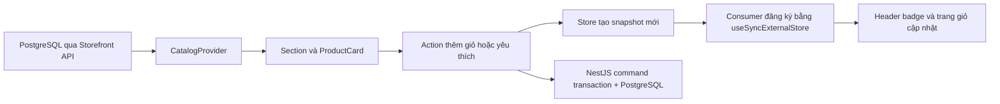

# Cấu trúc frontend Rigforge

Chi tiết và PC Builder cập nhật **19/11/2026**: chỉ dùng ảnh phẳng, đã gỡ GLB và Three/Fiber/Drei/types. `ProductGallery` dùng `PhotoTilt` và Dialog phóng to. Builder dùng `assembled-layers.tsx` + `assembly-visuals.ts`, binding slug/SKU/profile case và dependency mainboard. Manifest thật đã có 2 case + 16 sản phẩm linh kiện, 76 entry và 18 tên PNG dựng bằng imagegen tích hợp; không lấy fixture SVG chạy production. Bộ hiện tại khai báo `verified: false`, `illustrative: true`, nguồn/prompt trong `public/images/pc-assembly/SOURCES.json`, nhãn chưa xác minh tỷ lệ hiển thị ở viewport. Tầng `verified: true` vẫn cần nguồn HTTPS và tư liệu/số đo thật. `Product.image` chỉ phục vụ inspector/picker. [Contract và bộ ảnh](ASSEMBLY_ASSET_PACK.md), [audit catalog](PRODUCT_IMAGE_AUDIT.md). Giá/tồn/thông số/checkout không đổi.

Crop part ghi vùng alpha PNG theo phần trăm canvas gốc; `aspectRatio` giữ tỷ lệ vùng alpha trong placement, không sửa bitmap/crop case. Có script đo lại alpha. Bộ PNG thực đã qua test case Mini + mainboard, cấu hình đề xuất, thay tám nhóm/case và mobile không cắt case; tổng 53 kiểm tra có mục tiêu qua, report `front/.visual-review/assembly-assets/core-results.json` + `readiness-results.json`. Build production qua; không coi ảnh AI là dữ liệu cơ khí đã xác minh. Manifest rỗng/45 test thuộc lượt trước.

Marquee cập nhật **18/11/2026**: nhóm dùng chiều rộng nội dung `w-max` thay `min-width:100vw` để không có khoảng rỗng sau pill cuối. Header đo một chuỗi 5 ưu đãi bằng ResizeObserver, lặp ít nhất hai lần và tăng nếu cần để mỗi nhóm phủ đủ viewport. Track gồm hai nhóm giống nhau, padding cuối bằng gap trong nhóm để điểm nối liền mạch với keyframe -50%. Chỉ 5 link gốc tham gia keyboard/screen reader. Điều chỉnh mật độ tại `reference_pills_group` trong `store-header.tsx`: đổi `gap` và `padding-right` cùng một giá trị; không dùng min-width/justify-between để trải giãn nhãn.

Landing cập nhật **18/11/2026**: thêm `ProductCollections` sau FlashSaleSection, render ba section PC & máy bộ (`pc`), Laptop (`laptop`), Gaming Gear (`gear`). Mỗi nhóm lọc từ CatalogProvider và chọn tối đa 8 sản phẩm theo thứ tự snapshot; không lấy sản phẩm nhóm khác bù khi thiếu. ProductRail/ProductCard dùng lại giá/ảnh/thông số và action hiện có; “Xem tất cả” tới catalog đúng category, empty state có nhãn cập nhật. Ba section trực tiếp tham gia reveal của LandingMotion. Landing hiện có **9 section**, nội dung biên tập sáu khối gốc bên dưới ghi lại mốc trước thay đổi này; không khôi phục toàn bộ shelf cũ. Test `tests/e2e/product-collections.spec.ts` đối chiếu nguồn API và cuộn mobile, các test căn lề được cập nhật số section.

Popup chào khách cập nhật **18/11/2026**: `WelcomePromotion` là client component gắn một lần tại StoreLayout trong Suspense riêng. Mỗi route mua sắm public có nội dung theo key pathname để cleanup timer/modal khi chuyển trang; không render trên auth/giỏ/checkout/PC Studio. Cookie phiên `rigforce-welcome-v1` và cờ bộ nhớ dự phòng ngăn lặp trong phiên; ghi khi timer thật sự mở sau hydration, không đọc browser API trong SSR. Native Dialog cung cấp top layer/khóa nền/focus/Escape, wrapper scoped giữ màu và bố cục riêng mà không sửa component dùng chung. CTA dùng route thật, ảnh biên tập local và nhãn preview; không có giá/coupon hoặc subscription form. Playwright config có preference đã xem cho các suite nghiệp vụ; suite popup tự bỏ storageState để kiểm lần truy cập đầu.

Khối thương hiệu cập nhật **17/11/2026**: `PartnerBrands` giữ nguồn tên từ presentation/catalog, mapping logo nằm cùng component và asset tại `public/images/brands/`. File local SVG/PNG giữ màu/tỷ lệ gốc; dùng `next/image` với object-contain/unoptimized, AMD trắng đặt trên card tối. Mapping không có hãng thì hiện tên dự phòng. Gallery mới giữ class `.rf-brand-tile` để dùng reveal/stagger chung và test; logo zoom 1.10, thẻ nhấc 6px có transition/focus/reduced motion. [Nguồn logo](BRAND_ASSETS.md). Không gắn logo bằng text hoặc tự tạo vector thương hiệu.

Chuyển động cập nhật **17/11/2026**: `motion.ts` giữ timing/easing, hover/press, zoom và utility reveal. `LandingMotion` (client, render một marker hidden) đọc sáu section anh em trong landing, chỉ dùng IntersectionObserver để đánh dấu khối ngoài viewport sau hydration; lúc vào viewport gỡ marker và stagger card bằng Web Animations API. Không có observer/JS thì controller không ẩn nội dung; reduced motion và keyboard focus hiển thị ngay; cleanup an toàn khi Next giữ/khôi phục route. Component không fetch hoặc giữ state nghiệp vụ. Style vẫn là utility Tailwind, không thêm thư viện animation; không animate chiều cao hoặc bố cục luồng trang.

Trang chủ cập nhật **17/11/2026**, sau phản hồi cần phong phú và rực rỡ hơn: `LandingPage` render sáu section `ForgeIntro` → `FlashSaleSection` → `ForgeStudio` → `CatalogDirectory` → `ForgeJournal` → `PartnerBrands`. Hero và Studio dùng hai ảnh biên tập mới tạo bằng image_gen, có nhãn minh họa; không tạo dữ liệu SKU/giá/tồn. Dịch vụ là ba link gọn trong hero; featuredDeals vẫn từ CatalogProvider và có empty state; directory tuyển tám danh mục có trong API với ảnh đại diện được chọn lại. Journal lấy ba bài từ API, giữ nội dung/link và chọn bìa minh họa theo chủ đề để tránh ảnh demo lặp. Partner lấy sáu tên dedupe từ presentation/catalog, ghi rõ minh họa demo; chưa xác minh quan hệ đối tác thật. Các route `/articles`, `/brands`, `/promotions`, `/showrooms` và menu vẫn hoạt động. Carousel/shelf cũ còn trong repo không phải tính năng đang được landing nạp.

Palette chung là tím điện/cyan/san hô: token `rf-accent`, `rf-accent-hover`, `rf-accent-soft`, `rf-ink`, `rf-ember`, `rf-cyan`; alias `rf-green`/`rf-mint`/`rf-sale` ánh xạ sang palette mới để tương thích consumer cũ. Ảnh hero zoom 1.08, Studio 1.10, sản phẩm 1.12, danh mục 1.16, bài viết 1.08 khi hover/focus, khung ảnh clip; reduced motion loại chuyển động chuyển tiếp. `ProductImage` lấy ảnh record catalog, tăng sizes để phù hợp card/zoom; ảnh nguồn cần đối chiếu đúng SKU. [Nguồn ảnh và prompt](VISUAL_ASSETS.md).

Header/search/quick nav, logo SVG, ribbon/giá card và footer dùng token chung; footer còn brand và ba nhóm link, mobile dùng details native. `route-layout.css` chỉ ẩn showroom chung khi marker là home; Link/Back đọc marker ngoài cache route. Giữ chỉnh sửa typography có sẵn trong workspace; layout dùng Tailwind v4, không thêm stylesheet feature/dependency. Bằng chứng và giới hạn xem mục Spectrum trong PROJECT_STATUS.

Ngày cập nhật: **06/11/2026**. Tài liệu mô tả mã hiện có sau lượt dựng lại landing theo ảnh full-page; khác với [bản kế hoạch UI/UX](UI_UX_PLAN.md), vốn mô tả phạm vi đích rộng hơn.

Mốc khảo sát website trực tiếp cùng ngày: [báo cáo](../../docs/REFERENCE_SITE_AUDIT.md). Header dùng presentation từ CatalogProvider/`StoreSearch`, catalog giữ query context. Kiểu dáng của các template đã chuyển sang utility Tailwind v4 trong component. Checkout dùng form một trang với header logo gọn; campaign/showroom dùng header điều hướng gọn riêng. `StoreRouteMarker` là client component nhỏ đọc `usePathname`, bọc Suspense và đặt trực tiếp trong layout, ngoài các trang Next giữ ẩn khi điều hướng. CSS `:has(> .rf-route-...)` trong `route-layout.css` chỉ đọc marker này: không dò sự tồn tại của component trang vì trang cũ vẫn có thể còn trong DOM và làm chọn nhầm header. Marker giữ class ban đầu giống nhau trên SSR/hydration bằng `useSyncExternalStore`, sau hydration mới áp URL hiện tại; tránh mismatch nếu người dùng chuyển trang trước khi layout hydrate. Đổi lại, header chuyên biệt chỉ xuất hiện sau hydration. Giá và trạng thái qua API; tạo đơn cần phiên xác thực server. Showroom footer chuyển vào `StoreLayout`, tránh lặp ở landing; trang showroom không lặp grid footer. Kết quả suite mới nhất ở [PROJECT_STATUS.md](../../docs/PROJECT_STATUS.md), có phân biệt kiểm UI, API và FE–BE thật.

## Bản đồ thư mục

```text
front/
  src/
    app/
      layout.tsx                 # Metadata, ngôn ngữ, provider toàn ứng dụng
      globals.css                # Điểm import CSS, không chứa toàn bộ style
      not-found.tsx
      (store)/                   # Layout chung; tên group không xuất hiện trong URL
        page.tsx                 # Route / gọi LandingPage
        layout.tsx               # Gắn StoreLayout
        loading.tsx / error.tsx
        products/ search/ cart/ checkout/ pc-builder/ ...
    features/
      landing/
        landing-page.tsx         # Server Component ghép các section
        data/shelf-data.ts       # Types và helper lọc thuần; nội dung nhóm từ DB
        components/              # Hero, flash, campaign, rail, shelf, directory, blog...
      catalog/                   # Danh sách, chi tiết SKU, so sánh
      cart/                      # Giỏ hàng
      checkout/                  # Checkout COD và trạng thái server
      auth/                      # Form xác thực qua API
      account/                   # Hồ sơ, wishlist và ticket từ API
      orders/                    # Chi tiết, trạng thái, timeline đơn
      pc-builder/
        lib/compatibility.ts     # Quy tắc thuần, độc lập renderer
        lib/assembly-visuals.ts   # Binding/tầng verified hoặc illustrative, crop metadata
        components/assembled-layers.tsx # Ghép ảnh lắp theo case/SKU, clipping/che khuất
        components/photo-assembly.tsx # Điều khiển ảnh, zoom và inspector catalog
      content/                   # Bài viết, FAQ, thông tin chính sách minh họa
      admin/                     # Tổng quan DB có phân quyền
    components/
      layout/                    # Header, footer, layout, điều hướng nhanh
      storefront/                # Card, SVG minh họa, breadcrumb, dialog...
      ui/                        # Primitive Button có sẵn, không chứa nghiệp vụ
    providers/
      shop-provider.tsx           # Phiên HttpOnly refresh, cart/orders/builds API
    hooks/
      use-api-resource.ts        # Tải dữ liệu private và hiển thị lỗi
    catalog/                     # Contract, server fetch, API client, CatalogProvider
    styles/
      tokens.css                 # Token + @theme inline cho utility Tailwind v4
      base.css                   # Reset toàn cục, accessibility và keyframe còn cần
      route-layout.css           # Đổi layout theo marker route, giữ đúng Link/Back
  tests/e2e/landing.spec.ts
  scripts/prepare-reference-assets.mjs # Chuẩn bị ảnh thủ công, không chạy lúc render
  scripts/review-landing.mjs     # Chụp và kiểm tràn ngang theo từng mốc review
  public/images/catalog/        # WebP và metadata nguồn ảnh
  playwright.config.ts
```

Các scaffold rỗng có sẵn không tự trở thành route và không cần xóa chỉ để làm sạch cây thư mục. Mã landing cũ đã được thay thế; không giữ hai header, hai bộ product card hoặc hai nguồn dữ liệu mẫu cùng phục vụ trang chủ.

## Ranh giới trách nhiệm

- **Route** nhận tham số Next.js, kiểm tra slug/404 và gọi feature. Không viết toàn bộ trang hoặc logic giỏ trong `app/.../page.tsx`.
- **Feature** giải quyết một nhu cầu nghiệp vụ. `landing-page.tsx` chỉ sắp xếp section; `HeroSection`, `CampaignSection`, từng `CategoryShelf` và `ReferenceJournal` giữ state riêng. Một thay đổi banner không làm mọi section giữ state chung.
- **Component dùng lại** nhận dữ liệu qua props. `CategoryShelf` nhận cấu hình nhóm/tab; `ProductRail` nhận sản phẩm và số cột, đo kích thước thực tế để cuộn. `ProductCard` có biến thể mặc định, shelf và flash; action giỏ vẫn dùng cùng store.
- **CatalogProvider/ShopProvider** chứa snapshot public/private từ API. Prisma và secret chỉ ở backend; access token trong bộ nhớ, refresh token qua HttpOnly cookie.
- **Fixture** là dữ liệu có ID ổn định. Deal và nhóm nâng cấp chọn bằng ID, không chọn bằng vị trí mảng dễ thay đổi.
- **Tailwind v4** đảm nhiệm layout, typography, màu sắc, responsive, hover và trạng thái. Các nhóm utility dài nằm trong hằng `tw` ngay trong file component; chuỗi utility luôn là literal đầy đủ để Tailwind quét được, không ghép tên utility từ dữ liệu runtime. Class `rf-*` được giữ làm marker cho trạng thái, selector của utility và E2E; không còn bộ CSS trình bày riêng cho từng feature.
- **Token** trong `tokens.css` giữ màu và khung nội dung; `@theme inline` cung cấp utility như `bg-rf-green`, `text-rf-muted`. Typography gốc nằm ở utility của root layout. `base.css` chỉ giữ mặc định toàn cục, focus/reduced motion và keyframe; `route-layout.css` giữ selector layout phụ thuộc route để tránh lỗi khi Next giữ trang cũ trong DOM. Sáu file CSS feature cũ chỉ còn chú thích, không được import.

Typography cập nhật **17/11/2026**, mở rộng sang catalog/chi tiết, tài khoản/auth, giỏ/checkout, đơn, PC Builder và trang nội dung. Body/input/select/textarea 16px; `text-rf-caption` 14px, `text-rf-small` 15px, `text-rf-body`/`text-rf-control` 16px. Token sản phẩm `text-rf-product`/`text-rf-product-compact` là 17/15px, thông số `text-rf-detail`/`text-rf-detail-compact` 15/14px, giá `text-rf-price`/`text-rf-price-compact` 22/20px ở root mặc định. Dùng rem để theo cỡ chữ trình duyệt; không giảm chữ nội dung theo vw. Base layer đặt `<small>` 14px để không bị thu nhỏ 80% khi lồng nhau; utility vẫn có thể chỉ định cỡ riêng cho logo/hình minh họa/badge số.

Tên sản phẩm có chiều cao theo em đủ hai dòng (shelf/flash) hoặc ba dòng (catalog), thông số xuống dòng. Laptop <=1440px dùng tối đa bốn cột catalog/rail, catalog <=1100px ba cột và mobile hai cột; các rail/tab cuộn trong vùng riêng. Form dài được cuộn dọc để giữ chữ dễ đọc; kiểm thử auth kiểm input >=16px, không tràn ngang và hành động luôn cuộn tới được, thay yêu cầu cũ ép toàn bộ form vào viewport thấp. PC Builder dùng cột linh hoạt và bốn nhãn ảnh mỗi hàng trên mobile. Chưa đồng nghĩa đã kiểm browser các màn hình riêng tư với dữ liệu thật hoặc mọi thiết bị vật lý.

Tất cả trang dùng `--rf-home-width` (hiện 1540 px) làm giới hạn nội dung, gồm catalog, chi tiết, giỏ, checkout, tài khoản, PC Builder, auth và nội dung/minisite. `StoreLayout` tính `--rf-content` bằng giới hạn này cộng hai gutter: 64 px mỗi bên từ 1024 px, 16 px ở màn hình nhỏ hơn. Main, showroom, footer và header minisite dùng chung khung; bỏ giới hạn cũ 1220/1100 px cùng giới hạn riêng của khung auth, kết quả đặt hàng và trang nội dung. Dialog, bảng thông số và form tra cứu bên trong vẫn có giới hạn riêng. Marker route chỉ điều khiển hiển thị header/footer theo URL, không quyết định chiều rộng; Link/Back giữ cùng khung. Header cửa hàng vẫn full width với padding 50 px trên desktop và 16 px trên mobile. Trang 404 áp dụng cùng công thức qua utility Tailwind.

Chuyển động dùng utility tĩnh tại `src/components/ui/motion.ts`: control/link/form 200 ms, menu và nội dung tab 200 ms, ảnh sản phẩm/banner 300 ms, dialog 150 ms. `StoreLayout` cung cấp mặc định cho control bằng selector `:where` để các hiệu ứng riêng vẫn có thể ghi đè; card/ảnh/tile dùng nhóm utility riêng. Chỉ chuyển màu, viền, shadow, opacity, scale/translate; không tween chiều rộng, chiều cao hay vị trí của container trang. Hero và quảng cáo dọc giữ nhịp chuyển đã có.

`Dialog` dùng `starting:open:*` để vào mềm, state `closing` để thoát trước khi unmount; sau 160 ms mới gọi `onClose`, cleanup trả focus về nút mở. Escape ngăn đóng native tức thì để đi qua cùng luồng; reduced motion bỏ hiệu ứng và đóng ngay. Animation vào dùng lại keyframe `rf-enter`; không thêm thư viện. Khi thêm hiệu ứng mới, dùng `motion-safe`/`motion-reduce` và không đặt transform lên tổ tiên chứa phần tử fixed. Kiểm thử hover, kích thước card và focus dialog ở cả hai chế độ trong `tests/e2e/motion.spec.ts`.

Alias hiện tại giữ `@/*` → root `front/`, nên mã nguồn dùng `@/src/...`. Không tự bỏ đoạn `src` trong import khi chưa đổi cấu hình đồng bộ.

## Luồng dữ liệu và hydration



Store giữ hai snapshot: snapshot server rỗng, ổn định và snapshot client được khôi phục bằng refresh cookie và API riêng tư. Mỗi consumer gọi `useSyncExternalStore`, vì header nằm trong Suspense có thể hydrate muộn hơn provider. Đưa toàn bộ state vào context rồi hydrate ở effect của cha có thể khiến header nhận badge giỏ mới trước khi khớp HTML server; bộ E2E đã bắt được tình huống này và cơ chế hiện tại đã sửa nó.

Context chỉ truyền instance store ổn định. Action đọc snapshot mới nhất để nhiều click liên tiếp không mất số lượng. Server kiểm tra tồn và transaction cho cả build; order chụp tên/phiên bản/giá/địa chỉ riêng. Tiền API lưu dưới dạng chuỗi số nguyên VND, tính bằng BigInt; không chuyển USD sang VND bằng thay ký hiệu.

Địa chỉ/ticket/preferences/review gọi API có ownership. Chỉ compare lưu local dưới key `rigforge-compare-v2`; state demo v1 không dùng làm phiên hay nguồn đơn. Không fallback sang fixture khi API lỗi.

Rà soát ngày 07/11/2026: action giỏ trả kết quả thành công và cung cấp `cartPending` để khóa thao tác trong lúc gửi; “Mua ngay” chỉ chuyển trang sau khi thêm giỏ thành công. API client xử lý proxy không trả JSON/HTTP 204 và phát `SESSION_EXPIRED` khi không khôi phục được phiên. Store xóa dữ liệu riêng, đánh số phiên để bỏ response giỏ/cấu hình/đơn đến trễ. `useApiResource` gắn kết quả với path/phiên reload, tránh hiển thị tài nguyên cũ dưới URL mới. Checkout kiểm SKU không còn trong catalog và thể hiện trạng thái tạo đơn; save dialog chỉ đóng khi API xác nhận lưu.

PC Studio dùng [bộ ảnh lắp theo SKU/case](PC_STUDIO.md) riêng với catalog. Renderer có cửa nhìn, thứ tự lớp, mặt nạ/foreground và phần bị che; inspector/picker dùng ảnh catalog. Pack chưa có thì báo thiếu, không dựng sản phẩm chung. Giảm chuyển động tắt chuyển tiếp nhưng giữ điều khiển đổi nền. Quy tắc tương thích vẫn độc lập với hình ảnh: thiếu thông số tạo warning, không kết luận socket/DDR/kích thước/công suất phù hợp từ giá trị mặc định 0/undefined.

Error boundary của App Router dùng `retry()` (Next 16.4) để tải lại server data; `reset()` chỉ xóa trạng thái lỗi. Global error tự import stylesheet vì thay thế root layout. [Báo cáo rà soát](../../docs/FRONTEND_READINESS_AUDIT.md) ghi bằng chứng và phần chưa được nghiệm thu.

## Server, client và tải tài nguyên

Đợt hoàn thiện chọn hàng 17/11/2026: catalog lưu `q/category/brand/min/max/inStock/sort/page` trong URL. `inStock=1` yêu cầu ít nhất một variant có tồn dương; đây là hiển thị theo snapshot, backend vẫn kiểm lại khi đặt hàng. Bộ lọc kỹ thuật hiện theo nhóm phù hợp và giá trị có trong snapshot; không phải facet truy vấn toàn DB. Xóa bộ lọc giữ category/q/sort, khoảng giá ngược được báo trước khi áp dụng. So sánh dùng thuộc tính có tên trong `technical` theo từng nhóm; `specs[]` là mô tả không có schema nhãn, không ghép theo index. Bộ lọc khác biệt phân biệt dữ liệu thiếu với ô khác nhóm; chưa có benchmark hoặc thông số bổ sung tự suy đoán. Kiểm tra hành vi tại `tests/e2e/shopping-decision.spec.ts`.

PC Studio giữ preset góc và màu nền là state trình diễn, không thay cấu hình. Ảnh ghép dùng bố cục tách có nhãn và focus làm mờ lớp khác; pose/zoom gắn với phiên reset góc nên reset không remount inspector. Renderer Three procedural của mốc 12/11/2026 đã gỡ ngày 18/11/2026. [PC_STUDIO.md](PC_STUDIO.md) ghi giới hạn hình minh họa và kết quả kiểm tương ứng trong PROJECT_STATUS.

Root layout đọc catalog runtime dưới Suspense; các section dùng CatalogProvider là Client Components. Hero/tab, rail, blog có filter, button dùng store, dialog và header tương tác cần client. Header không còn đọc pathname; lớp Suspense ở layout vẫn được giữ để cô lập hydration.

Landing dùng logo, banner và 153 ảnh WebP local, icon cùng nội dung HTML/CSS; không tải model 3D hoặc API bên ngoài. `ProductImage` dùng Next Image khi có đường dẫn local; ảnh thiếu/lỗi hiện biểu tượng và thông báo trung tính. Không có fallback ảnh chung để ngụ ý đúng sản phẩm. Dữ liệu catalog mẫu còn ảnh gán sai model; xem [đối chiếu ảnh](PRODUCT_IMAGE_AUDIT.md).

Các sản phẩm snapshot mới có `builderEligible=false` vì thiếu bộ thông số tương thích đã chuẩn hóa. Picker PC Studio chỉ dùng sản phẩm có thuộc tính kỹ thuật/builderEligible trong database; không suy ra socket, DDR hoặc kích thước từ tên/ảnh sản phẩm. [REFERENCE_LANDING.md](REFERENCE_LANDING.md) ghi nguồn tài nguyên và quy trình đối chiếu.

Font hệ thống hỗ trợ tiếng Việt thay dependency runtime/build vào Google Fonts. Animation có `prefers-reduced-motion`. Hero dùng đủ 6 banner local, tự chuyển sau 3 giây và có tạm dừng; dừng tự chuyển khi thao tác bàn phím trong carousel. Khung Hero dùng `w-full max-w-[var(--rf-home-width)]` trong container chung; nút mũi tên giữ kiểu cũ, luôn hiển thị. Hai banner quảng cáo dọc bám mép màn hình bằng `fixed`, khuất 50% khi nghỉ và hiện đủ khi hover/focus; khung clip tránh tràn ngang. Hiện trên desktop/laptop từ 1024 px, ẩn trên màn hình nhỏ hơn. Header chính và các hàng utility/ưu đãi/menu dùng full width, padding ngang 50 px; mobile dưới 768 px dùng 16 px.

## Cách mở rộng

1. Thêm section landing: tạo component trong `features/landing/components`, đưa cấu hình dải danh mục vào `data/shelf-data.ts`, ghép section mới trong `landing-page.tsx`.
2. Tạo nhóm sản phẩm: thêm `ShelfDefinition` và điều kiện tab; dùng `CategoryShelf`/`ProductRail` cùng `ProductCard` để bố cục và hành vi giỏ nhất quán. Các section cũ chưa được ghép không tham gia render landing hiện hành.
3. Thêm một trang: tạo route mỏng ở `app/(store)`, đặt UI/logic trong feature phù hợp, bổ sung loading/empty/error khi có dữ liệu phụ thuộc URL.
4. Thêm dữ liệu hiển thị ở seed/API, không đặt fixture hoặc fallback nghiệp vụ trong frontend. Giá, ownership, trạng thái luôn do backend xác nhận.
5. Chú thích code: giải thích **mục đích, nguồn dữ liệu, điều kiện biên và trade-off** ở logic khó; tránh comment chỉ nhắc lại cú pháp JSX.

## Mức hoàn thành và giới hạn

Landing đã có header/mega menu/search, hero 6 chiến dịch, 4 banner dịch vụ, flash sale, campaign, 9 dải danh mục có tab và rail, directory, thương hiệu, 3 bài khuyến mãi, blog có lọc/tìm kiếm, 8 showroom mẫu và footer. CTA gọi các route dùng API; giỏ, yêu thích và cấu hình lưu trên server. Showroom không phải địa chỉ đang hoạt động; không gắn chứng nhận doanh nghiệp chưa xác minh.

Các trang phụ là bản minh họa hỗ trợ luồng, chưa hoàn tất toàn bộ kế hoạch 102 model. Admin đọc aggregate thật có permission guard. Hậu mãi mới ghi nhận yêu cầu cấp đơn; tra serial chỉ trong đơn sở hữu, chưa có chọn dòng trả/số lượng, inspection, refund allocation hoặc workflow vận hành đầy đủ. PC Studio dùng ảnh dựng AI có binding SKU riêng; hình học và tỷ lệ vẫn minh họa, chưa có vật lý/kiểm định BIOS/đầu nguồn/lane/khe hở thực tế.

Suite UI không thay thế test API/transaction. Runner fullstack hiện kiểm COD thật qua PostgreSQL riêng; Stripe, giao vận, production/Nginx và AWS chưa nghiệm thu. Xem [contract và giới hạn](../../docs/API_STOREFRONT_COMMERCE_V2.md).

## Lệnh kiểm tra

```powershell
# Chạy trong front/
npm run dev
npm run lint
npm run format:check
npm run build
npx playwright install chromium
npm run test:e2e
```

Playwright dùng server local cổng 3000, tái sử dụng nếu đang chạy. Ảnh review desktop/mobile dùng `testInfo.outputPath` trong `test-results-local/`, trace được giữ khi lỗi; các artifact này được gitignore. Trên Windows, Next.js dùng `.next-local-<hash-tài-khoản>/` cho dev/build/start: `whoami.exe` đọc danh tính thực, SHA-256 rút gọn thành hậu tố ổn định. Không dùng biến `USERNAME` vì sandbox có thể kế thừa tên người dùng thật. Mỗi tài khoản sở hữu cache riêng, tránh lỗi xóa cache của tài khoản khác; không đổi ACL hoặc xóa cache cũ. Linux giữ `.next-local/` cố định cho build/runtime khác UID. TypeScript chỉ quét source/test/config và generated types của output mới (Next tự thêm đường dẫn cụ thể); ESLint bỏ qua `.next*/**`.

Đợt sửa runtime 06/11/2026 bổ sung: chỉ mount form tài khoản/checkout sau khi store khôi phục user, kiểm tra phần tử dữ liệu local của địa chỉ/ticket/review. Các xử lý camera/WebGL và cảnh báo Three ở mốc đó thuộc renderer lịch sử, đã được gỡ cùng dependency ngày 18/11/2026.

Lần kiểm tra cuối và giới hạn thực tế ghi trong [PROJECT_STATUS.md](../../docs/PROJECT_STATUS.md).
