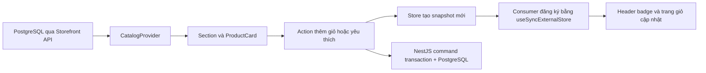

# Cấu trúc frontend Rigforge

Ngày cập nhật: **06/11/2026**. Tài liệu mô tả mã hiện có sau lượt dựng lại landing theo ảnh full-page; khác với [bản kế hoạch UI/UX](UI_UX_PLAN.md), vốn mô tả phạm vi đích rộng hơn.

Mốc khảo sát website trực tiếp cùng ngày: [báo cáo](../../docs/REFERENCE_SITE_AUDIT.md). Header dùng presentation từ CatalogProvider/`StoreSearch`, catalog giữ query context. Kiểu dáng của các template đã chuyển sang utility Tailwind v4 trong component. Checkout dùng form một trang với header logo gọn; campaign/showroom dùng header điều hướng gọn riêng. `StoreRouteMarker` là client component nhỏ đọc `usePathname`, bọc Suspense và đặt trực tiếp trong layout, ngoài các trang Next giữ ẩn khi điều hướng. CSS `:has(> .rf-route-...)` trong `route-layout.css` chỉ đọc marker này: không dò sự tồn tại của component trang vì trang cũ vẫn có thể còn trong DOM và làm chọn nhầm header. Marker giữ class ban đầu giống nhau trên SSR/hydration bằng `useSyncExternalStore`, sau hydration mới áp URL hiện tại; tránh mismatch nếu người dùng chuyển trang trước khi layout hydrate. Đổi lại, header chuyên biệt chỉ xuất hiện sau hydration. Giá và trạng thái qua API; tạo đơn cần phiên xác thực server. Showroom footer chuyển vào `StoreLayout`, tránh lặp ở landing; trang showroom không lặp grid footer. Kết quả suite mới nhất ở [PROJECT_STATUS.md](../../docs/PROJECT_STATUS.md), có phân biệt kiểm UI, API và FE–BE thật.

## Bản đồ thư mục

```text
front/
  src/
    app/
      layout.tsx                 # Metadata, ngôn ngữ, provider toàn ứng dụng
      globals.css                # Điểm import CSS, không chứa toàn bộ style
      not-found.tsx
      (store)/                   # Layout chung; tên group không xuất hiện trong URL
        page.tsx                 # Route / gọi LandingPage
        layout.tsx               # Gắn StoreLayout
        loading.tsx / error.tsx
        products/ search/ cart/ checkout/ pc-builder/ ...
    features/
      landing/
        landing-page.tsx         # Server Component ghép các section
        data/shelf-data.ts       # Types và helper lọc thuần; nội dung nhóm từ DB
        components/              # Hero, flash, campaign, rail, shelf, directory, blog...
      catalog/                   # Danh sách, chi tiết SKU, so sánh
      cart/                      # Giỏ hàng
      checkout/                  # Checkout COD và trạng thái server
      auth/                      # Form xác thực qua API
      account/                   # Hồ sơ, wishlist và ticket từ API
      orders/                    # Chi tiết, trạng thái, timeline đơn
      pc-builder/
        lib/compatibility.ts     # Quy tắc thuần, độc lập renderer
        components/pc-scene.tsx  # Renderer Three.js tải động
      content/                   # Bài viết, FAQ, thông tin chính sách minh họa
      admin/                     # Tổng quan DB có phân quyền
    components/
      layout/                    # Header, footer, layout, điều hướng nhanh
      storefront/                # Card, SVG minh họa, breadcrumb, dialog...
      ui/                        # Primitive Button có sẵn, không chứa nghiệp vụ
    providers/
      shop-provider.tsx           # Phiên HttpOnly refresh, cart/orders/builds API
    hooks/
      use-api-resource.ts        # Tải dữ liệu private và hiển thị lỗi
    catalog/                     # Contract, server fetch, API client, CatalogProvider
    styles/
      tokens.css                 # Token + @theme inline cho utility Tailwind v4
      base.css                   # Reset toàn cục, accessibility và keyframe còn cần
      route-layout.css           # Đổi layout theo marker route, giữ đúng Link/Back
  tests/e2e/landing.spec.ts
  scripts/prepare-reference-assets.mjs # Chuẩn bị ảnh thủ công, không chạy lúc render
  scripts/review-landing.mjs     # Chụp và kiểm tràn ngang theo từng mốc review
  public/images/catalog/        # WebP và metadata nguồn ảnh
  playwright.config.ts
```

Các scaffold rỗng có sẵn không tự trở thành route và không cần xóa chỉ để làm sạch cây thư mục. Mã landing cũ đã được thay thế; không giữ hai header, hai bộ product card hoặc hai nguồn dữ liệu mẫu cùng phục vụ trang chủ.

## Ranh giới trách nhiệm

- **Route** nhận tham số Next.js, kiểm tra slug/404 và gọi feature. Không viết toàn bộ trang hoặc logic giỏ trong `app/.../page.tsx`.
- **Feature** giải quyết một nhu cầu nghiệp vụ. `landing-page.tsx` chỉ sắp xếp section; `HeroSection`, `CampaignSection`, từng `CategoryShelf` và `ReferenceJournal` giữ state riêng. Một thay đổi banner không làm mọi section giữ state chung.
- **Component dùng lại** nhận dữ liệu qua props. `CategoryShelf` nhận cấu hình nhóm/tab; `ProductRail` nhận sản phẩm và số cột, đo kích thước thực tế để cuộn. `ProductCard` có biến thể mặc định, shelf và flash; action giỏ vẫn dùng cùng store.
- **CatalogProvider/ShopProvider** chứa snapshot public/private từ API. Prisma và secret chỉ ở backend; access token trong bộ nhớ, refresh token qua HttpOnly cookie.
- **Fixture** là dữ liệu có ID ổn định. Deal và nhóm nâng cấp chọn bằng ID, không chọn bằng vị trí mảng dễ thay đổi.
- **Tailwind v4** đảm nhiệm layout, typography, màu sắc, responsive, hover và trạng thái. Các nhóm utility dài nằm trong hằng `tw` ngay trong file component; chuỗi utility luôn là literal đầy đủ để Tailwind quét được, không ghép tên utility từ dữ liệu runtime. Class `rf-*` được giữ làm marker cho trạng thái, selector của utility và E2E; không còn bộ CSS trình bày riêng cho từng feature.
- **Token** trong `tokens.css` giữ màu và khung nội dung; `@theme inline` cung cấp utility như `bg-rf-green`, `text-rf-muted`. Typography gốc nằm ở utility của root layout. `base.css` chỉ giữ mặc định toàn cục, focus/reduced motion và keyframe; `route-layout.css` giữ selector layout phụ thuộc route để tránh lỗi khi Next giữ trang cũ trong DOM. Sáu file CSS feature cũ chỉ còn chú thích, không được import.

Tất cả trang dùng `--rf-home-width` (hiện 1540 px) làm giới hạn nội dung, gồm catalog, chi tiết, giỏ, checkout, tài khoản, PC Builder, auth và nội dung/minisite. `StoreLayout` tính `--rf-content` bằng giới hạn này cộng hai gutter: 64 px mỗi bên từ 1024 px, 16 px ở màn hình nhỏ hơn. Main, showroom, footer và header minisite dùng chung khung; bỏ giới hạn cũ 1220/1100 px cùng giới hạn riêng của khung auth, kết quả đặt hàng và trang nội dung. Dialog, bảng thông số và form tra cứu bên trong vẫn có giới hạn riêng. Marker route chỉ điều khiển hiển thị header/footer theo URL, không quyết định chiều rộng; Link/Back giữ cùng khung. Header cửa hàng vẫn full width với padding 50 px trên desktop và 16 px trên mobile. Trang 404 áp dụng cùng công thức qua utility Tailwind.

Chuyển động dùng utility tĩnh tại `src/components/ui/motion.ts`: control/link/form 200 ms, menu và nội dung tab 200 ms, ảnh sản phẩm/banner 300 ms, dialog 150 ms. `StoreLayout` cung cấp mặc định cho control bằng selector `:where` để các hiệu ứng riêng vẫn có thể ghi đè; card/ảnh/tile dùng nhóm utility riêng. Chỉ chuyển màu, viền, shadow, opacity, scale/translate; không tween chiều rộng, chiều cao hay vị trí của container trang. Hero và quảng cáo dọc giữ nhịp chuyển đã có.

`Dialog` dùng `starting:open:*` để vào mềm, state `closing` để thoát trước khi unmount; sau 160 ms mới gọi `onClose`, cleanup trả focus về nút mở. Escape ngăn đóng native tức thì để đi qua cùng luồng; reduced motion bỏ hiệu ứng và đóng ngay. Animation vào dùng lại keyframe `rf-enter`; không thêm thư viện. Khi thêm hiệu ứng mới, dùng `motion-safe`/`motion-reduce` và không đặt transform lên tổ tiên chứa phần tử fixed. Kiểm thử hover, kích thước card và focus dialog ở cả hai chế độ trong `tests/e2e/motion.spec.ts`.

Alias hiện tại giữ `@/*` → root `front/`, nên mã nguồn dùng `@/src/...`. Không tự bỏ đoạn `src` trong import khi chưa đổi cấu hình đồng bộ.

## Luồng dữ liệu và hydration



Store giữ hai snapshot: snapshot server rỗng, ổn định và snapshot client được khôi phục bằng refresh cookie và API riêng tư. Mỗi consumer gọi `useSyncExternalStore`, vì header nằm trong Suspense có thể hydrate muộn hơn provider. Đưa toàn bộ state vào context rồi hydrate ở effect của cha có thể khiến header nhận badge giỏ mới trước khi khớp HTML server; bộ E2E đã bắt được tình huống này và cơ chế hiện tại đã sửa nó.

Context chỉ truyền instance store ổn định. Action đọc snapshot mới nhất để nhiều click liên tiếp không mất số lượng. Server kiểm tra tồn và transaction cho cả build; order chụp tên/phiên bản/giá/địa chỉ riêng. Tiền API lưu dưới dạng chuỗi số nguyên VND, tính bằng BigInt; không chuyển USD sang VND bằng thay ký hiệu.

Địa chỉ/ticket/preferences/review gọi API có ownership. Chỉ compare lưu local dưới key `rigforge-compare-v2`; state demo v1 không dùng làm phiên hay nguồn đơn. Không fallback sang fixture khi API lỗi.

## Server, client và tải tài nguyên

Root layout đọc catalog runtime dưới Suspense; các section dùng CatalogProvider là Client Components. Hero/tab, rail, blog có filter, button dùng store, dialog và header tương tác cần client. Header không còn đọc pathname; lớp Suspense ở layout vẫn được giữ để cô lập hydration.

Landing dùng logo, banner và 153 ảnh WebP local, icon cùng nội dung HTML/CSS; không tải model 3D hoặc API bên ngoài. `ProductImage` dùng Next Image khi có đường dẫn local, fallback SVG cho dữ liệu chưa có ảnh. `pc-scene.tsx` chỉ được import động từ builder phía client khi chuyển sang 3D. Ảnh gắn cho fixture gốc có tính minh họa nhóm; chưa phải ảnh/model chính xác của từng SKU.

Các sản phẩm snapshot mới có `builderEligible=false` vì thiếu bộ thông số tương thích đã chuẩn hóa. Picker PC Studio chỉ dùng sản phẩm có thuộc tính kỹ thuật/builderEligible trong database; không suy ra socket, DDR hoặc kích thước từ tên/ảnh sản phẩm. [REFERENCE_LANDING.md](REFERENCE_LANDING.md) ghi nguồn tài nguyên và quy trình đối chiếu.

Font hệ thống hỗ trợ tiếng Việt thay dependency runtime/build vào Google Fonts. Animation có `prefers-reduced-motion`. Hero dùng đủ 6 banner local, tự chuyển sau 3 giây và có tạm dừng; dừng tự chuyển khi thao tác bàn phím trong carousel. Khung Hero dùng `w-full max-w-[var(--rf-home-width)]` trong container chung; nút mũi tên giữ kiểu cũ, luôn hiển thị. Hai banner quảng cáo dọc bám mép màn hình bằng `fixed`, khuất 50% khi nghỉ và hiện đủ khi hover/focus; khung clip tránh tràn ngang. Hiện trên desktop/laptop từ 1024 px, ẩn trên màn hình nhỏ hơn. Header chính và các hàng utility/ưu đãi/menu dùng full width, padding ngang 50 px; mobile dưới 768 px dùng 16 px.

## Cách mở rộng

1. Thêm section landing: tạo component trong `features/landing/components`, đưa cấu hình dải danh mục vào `data/shelf-data.ts`, ghép section mới trong `landing-page.tsx`.
2. Tạo nhóm sản phẩm: thêm `ShelfDefinition` và điều kiện tab; dùng `CategoryShelf`/`ProductRail` cùng `ProductCard` để bố cục và hành vi giỏ nhất quán. Các section cũ chưa được ghép không tham gia render landing hiện hành.
3. Thêm một trang: tạo route mỏng ở `app/(store)`, đặt UI/logic trong feature phù hợp, bổ sung loading/empty/error khi có dữ liệu phụ thuộc URL.
4. Thêm dữ liệu hiển thị ở seed/API, không đặt fixture hoặc fallback nghiệp vụ trong frontend. Giá, ownership, trạng thái luôn do backend xác nhận.
5. Chú thích code: giải thích **mục đích, nguồn dữ liệu, điều kiện biên và trade-off** ở logic khó; tránh comment chỉ nhắc lại cú pháp JSX.

## Mức hoàn thành và giới hạn

Landing đã có header/mega menu/search, hero 6 chiến dịch, 4 banner dịch vụ, flash sale, campaign, 9 dải danh mục có tab và rail, directory, thương hiệu, 3 bài khuyến mãi, blog có lọc/tìm kiếm, 8 showroom mẫu và footer. CTA gọi các route dùng API; giỏ, yêu thích và cấu hình lưu trên server. Showroom không phải địa chỉ đang hoạt động; không gắn chứng nhận doanh nghiệp chưa xác minh.

Các trang phụ là bản minh họa hỗ trợ luồng, chưa hoàn tất toàn bộ kế hoạch 102 model. Admin đọc aggregate thật có permission guard. Hậu mãi mới ghi nhận yêu cầu cấp đơn; tra serial chỉ trong đơn sở hữu, chưa có chọn dòng trả/số lượng, inspection, refund allocation hoặc workflow vận hành đầy đủ. PC Studio dùng hình học và quy tắc mock, chưa phải mô phỏng lắp ráp chính xác từng SKU, chưa có vật lý/kiểm định BIOS/đầu nguồn/lane/khe hở thực tế.

Suite UI không thay thế test API/transaction. Runner fullstack hiện kiểm COD thật qua PostgreSQL riêng; Stripe, giao vận, production/Nginx và AWS chưa nghiệm thu. Xem [contract và giới hạn](../../docs/API_STOREFRONT_COMMERCE_V2.md).

## Lệnh kiểm tra

```powershell
# Chạy trong front/
npm run dev
npm run lint
npm run format:check
npm run build
npx playwright install chromium
npm run test:e2e
```

Playwright dùng server local cổng 3000, tái sử dụng nếu đang chạy. Ảnh review desktop/mobile dùng `testInfo.outputPath` trong `test-results-local/`, trace được giữ khi lỗi; các artifact này được gitignore. Trên Windows, Next.js dùng `.next-local-<hash-tài-khoản>/` cho dev/build/start: `whoami.exe` đọc danh tính thực, SHA-256 rút gọn thành hậu tố ổn định. Không dùng biến `USERNAME` vì sandbox có thể kế thừa tên người dùng thật. Mỗi tài khoản sở hữu cache riêng, tránh lỗi xóa cache của tài khoản khác; không đổi ACL hoặc xóa cache cũ. Linux giữ `.next-local/` cố định cho build/runtime khác UID. TypeScript chỉ quét source/test/config và generated types của output mới (Next tự thêm đường dẫn cụ thể); ESLint bỏ qua `.next*/**`.

Đợt sửa runtime 06/11/2026 bổ sung: chỉ mount form tài khoản/checkout sau khi store khôi phục user, kiểm tra phần tử dữ liệu local của địa chỉ/ticket/review, và reset camera bằng controls thay vì unmount Canvas. Listener mất WebGL context được gỡ khi unmount, nên đóng scene chủ động không bị hiểu thành lỗi GPU. Cảnh 3D dùng PCFShadowMap được hỗ trợ bởi bản Three.js hiện tại; còn cảnh báo `THREE.Clock` từ React Three Fiber, chưa đổi/hotpatch dependency để xóa cảnh báo đó.

Lần kiểm tra cuối và giới hạn thực tế ghi trong [PROJECT_STATUS.md](../../docs/PROJECT_STATUS.md).
